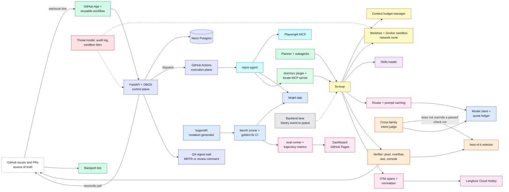
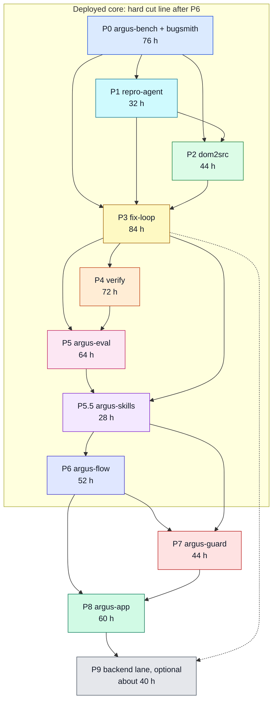

# Argus — learning plan

Argus is a pipeline that turns a UI bug ticket into a verified fix: reproduce the bug, find the source, fix it in a sandbox, verify the result, and hand it back as a pull request. You build it to learn the agentic layer at architect level, coming from backend engineering.

This file is the master plan. The detail lives in:
- [`phases/`](phases/): one file per phase (P0 to P9, plus P5.5), each with tasks, break-it tasks, an ablation and the ADRs to write.
- [`TASKS.md`](TASKS.md): one flat checklist in execution order, generated from the phase tables.
- [`repo-structure.md`](repo-structure.md): the monorepo layout and the language of each package.

## Constraints that shape everything
- **Profile.** [`config/profiles.md`](config/profiles.md) selects `personal` or `company`. **`personal` is $0 spend.** Free, open-source tools only. Every model is open-weight, run on a free hosted tier or locally. `company` may name a paid model API and a paid host. The model and infrastructure tables in this file are the personal profile.
- **20 hours a week.**
- **Free sandboxes.** The machine is a 13th-gen i7 (i7-13620H), 16 GB RAM, no discrete GPU, Docker 29.5 and WSL2 Ubuntu.
- **Free-tier prompts may be used for training.** Only synthetic or public code goes through them. The P8 install target must be one of your own public repos.
- **No application code is written in the planning step.** This folder holds documents only. Every results table ships empty; no numbers are invented.

## Learning rules
- **[ME] owns:** the agent loop, tool schemas, context manager, verifier, judge rubric and calibration, eval scorer, workflow state machine, threat model and all ADRs.
- **[CLAUDE] owns:** the target-app binding to dcortex (`config/platform.md`), seeded-bug boilerplate, CI YAML, Dockerfiles, dashboards and glue. The Canvas UI already lives in dcortex-platform. Argus does not scaffold a second one.
- **[PAIR]:** you write it and Claude reviews.
- **No agent framework before the P3 baseline.** Any framework after that needs an ADR (ADR-011 sets the bar).
- **Every phase ends with an ablation table** and reports resolve rate, tokens/bug, $-equivalent and p50/p95 latency against the previous phase.
- **Every phase starts with a T00 task** that re-verifies the pinned versions below, because phases begin months from now.
- **No invented numbers.** A results cell stays `—` until a real run fills it.

## $0 stack

### Models (all OpenAI-compatible, so one thin client covers them)
| Role | Model (open weights) | Host | Why |
|---|---|---|---|
| Fixer (strong) | Devstral 2 / Devstral Small 2 | Mistral free tier | A coding-agent model. The Mistral pricing page does not state these names, Apache-2.0 for Small, or 68–72% on SWE-bench Verified. No replacement number is written here |
| Cheap tier (repro, localize) | openai/gpt-oss-20b, qwen/qwen3.8-27b | Developer-plan base limits, organization level: RPM 30, RPD 1K, TPM 8K, TPD 200K. Cached tokens do not count. "free tier" is not stated. Qwen3.6-27B is not stated | Prompt caching becomes a *quota* lever you can measure, not just a cost lever |
| Intent judge (cross-family, vision) | Gemma 4 (Google family) | Local Ollama `gemma4:e4b` on CPU for the ~100-pair calibration; a free hosted Gemma for runtime if a P0 check confirms one exists | A different family from the Mistral fixer |
| Same-family judge (ablation control) | A Mistral vision model | Mistral free tier | Gives the self-preference comparison something to measure against |
| Embeddings (pgvector ablation) | Local open embedding model | Ollama / sentence-transformers on CPU | Free, and runs offline |

The limits above are what was found on the web. Mistral no longer publishes its free-tier numbers, so **P0-T06 measures every limit** and records it in `docs/quotas.md`; the plan trusts that file over this table.

### Infrastructure
| Concern | Choice |
|---|---|
| CI and execution plane | **GitHub Actions** on a public repo. Standard minutes are free, Docker is available, and Linux runners exposing `/dev/kvm` since Oct 2025 is not stated on the Actions billing page. Firecracker and gVisor tier measurements are still the P7 work |
| Control plane (P6) | **Render free web service** running FastAPI with DBOS in-process, plus **Neon free Postgres**. Render's free Postgres expires after 30 days, so it is not used |
| Traces | OTLP to **Langfuse Cloud Hobby** (free, 50k units/month). MIT is not stated on the pricing page. The pricing page says Langfuse is open source and can be self-hosted for free. Spans are OTLP, so the backend can be swapped; the P5 normalizer task proves it. Phoenix stays an alternative; its ELv2 licence is noted in ADR-015 |
| Dashboard | GitHub Pages, as a static site |
| Sandboxes | Docker `--network none` locally and on Actions, then gVisor, then Firecracker on the Actions KVM runner. Each tier is measured in P7 and written up in ADR-025 |

### Versions checked on 2026-10-30
| Component | Version |
|---|---|
| React | 19.3.1 |
| Vite | 8.3.5 (npm description: "Native-ESM powered web dev build tool". README: the production build bundles with Rolldown) |
| Tailwind | 4.3.3 |
| Playwright | 1.64.1 (npm dependencies: `playwright-core` only. Whether `playwright-core` embeds an MCP server is not stated. MCP is the separate `@playwright/mcp` package) |
| `@playwright/mcp` | 0.0.83 |
| MCP spec | **2026-07-28**: stateless core, MRTR `input_required` / `inputResponses`, Tasks moved to the `io.modelcontextprotocol/tasks` extension |
| MCP Python SDK | 2.3.0 |
| DBOS Python | 3.x |
| OTel GenAI semconv | `model/manifest.yaml` stability: development. Manifest `schema_url`: `https://opentelemetry.io/schemas/gen-ai-dev/1.42.0-dev`. README schema URL: TODO. Core semconv dependency: v1.44.0. Core semconv v1.42.0 (2026-06-12) moved `gen_ai.*` to this repo. README: "This repository extends the OpenTelemetry Semantic Conventions with GenAI-specific conventions." |

2026-10-30: version pins unchanged. React 19.3.1, Vite 8.3.5, Tailwind 4.3.3, Playwright 1.64.1, `@playwright/mcp` 0.0.83, MCP spec 2026-07-28, MCP Python SDK 2.3.0, and DBOS Python 3.x (PyPI `dbos` latest stable 3.4.0) match the previous check. Vite's npm description is still "Native-ESM powered web dev build tool", and the v8.3.5 README still says the production build bundles with Rolldown. Playwright 1.64.1's npm dependency list is still `playwright-core` only. Whether `playwright-core` 1.64.1 embeds an MCP server is still not stated: the v1.64.1 README does not mention MCP. `@playwright/mcp` stays its own row. The pinned rows use each registry's `latest` tag. The Playwright `next` dist-tag is `1.65.0-alpha-2026-10-29`, and `@playwright/mcp` 0.0.83's own npm dependencies are `playwright` and `playwright-core` at `1.64.0-alpha-1790635538000`; tool schemas from those trees stay off these rows. The MCP spec's latest stable GitHub release is still 2026-07-28, and the three changes named in that row are unchanged. The MCP Python SDK 2.3.0 package page does not name a spec date. OTel GenAI `stability: development` and the README schema URL TODO are unchanged. The row now also records the manifest `schema_url` and the core semconv dependency v1.44.0. The v1.42.0 move on 2026-06-12 is unchanged. The manifest's last commit is 2026-08-04.

2026-10-30, P2-T00: pins re-checked. React 19.3.1, Vite 8.3.5, Tailwind 4.3.3, Playwright 1.64.1, `@playwright/mcp` 0.0.83, MCP spec 2026-07-28, MCP Python SDK 2.3.0, and DBOS Python 3.x (PyPI `dbos` latest stable 3.4.0) are unchanged. Vite's npm description is still "Native-ESM powered web dev build tool", and the v8.3.5 README still says the production build bundles with Rolldown. Playwright 1.64.1 still depends only on `playwright-core`. The v1.64.1 `playwright-core` README still does not mention MCP. `@playwright/mcp` 0.0.83 still depends on `playwright` and `playwright-core` at `1.64.0-alpha-1790635538000`. The Playwright `next` dist-tag is now `1.65.0-alpha-2026-10-30`. That tag stays off the pinned row. The MCP spec's latest stable GitHub release is still tag `2026-07-28`, not a draft and not a prerelease, with `updated_at` `2026-07-28T16:47:49Z`. The MCP Python SDK 2.3.0 page still does not name a spec date. OTel GenAI `stability: development`, manifest `schema_url` `https://opentelemetry.io/schemas/gen-ai-dev/1.42.0-dev`, README schema URL TODO, core semconv dependency v1.44.0, and the manifest's last commit on 2026-08-04 are unchanged.

- **React 19 source mapping.** Re-check the React 19.2 removal of `source`/`self` from `jsxDEV` against React 19.3.1. The build-time `data-src` attribute remains the P2 route (ADR-006). Checked 2026-10-29: Babel's jsx-development docs still say those arguments were removed in React 19.2, and the React 19.3 changelog index lists no reversal. Checked again 2026-10-30 for P2-T00: Babel's `sourceSelf` option still says those arguments were removed since React 19.2. The React 19.3 blog's notable-changes list does not mention `jsxDEV` or `_debugSource`.
- Re-verified by the T00 task at the start of every phase.

## Architecture
Each block is coloured by the phase that adds it.

| Colour | Phase | Blocks |
|---|---|---|
| Blue | P0 | model client + quota ledger, target-app, bench scorer, bugsmith |
| Cyan | P1 | repro-agent, Playwright MCP |
| Green | P2 | dom2src plugin, locate MCP server |
| Yellow | P3 | fix-loop, context budget manager, worktree + Docker sandbox |
| Orange | P4 | verifier, intent judge, best-of-k |
| Pink | P5 | eval runner, OTel spans, Langfuse, router, dashboard |
| Purple | P5.5 | skills loader |
| Indigo | P6 | FastAPI + DBOS, Neon, Actions execution plane, QA signal |
| Red | P7 | threat model, audit log, sandbox tiers |
| Emerald | P8 | GitHub App, reusable workflow, backport bot, planner + subagents |
| Grey | P9 | backend lane (optional) |

## Phase dependency graph

## Phase map
Hours are at 20 h/week. Task counts and hours come from the phase tables and add up to the budget exactly.

| P | Package | Est h | Tasks | Additions | Ablation |
|---|---|---|---|---|---|
| 0 | argus-bench + bugsmith | 76 | 32 | Quota ledger; JSX/CSS mutation generator (deterministic, no LLM) toward 300+ tasks | Seeded vs mutated bugs: do they get the same resolve rate under a fixed baseline agent? |
| 1 | repro-agent | 32 | 17 | Playwright MCP | Ticket text only vs text plus screenshot |
| 2 | dom2src | 44 | 20 | Vite plugin; `locate()` MCP server. Whether the pinned server implements spec 2026-07-28 is not stated | Repo-map/LSP vs pgvector: top-1 file accuracy |
| 3 | fix-loop | 84 | 34 | Loop from scratch; worktree and Docker sandbox; ast-grep; gates; context budget manager; AGENTS.md | No compaction vs output caps vs offload-to-files vs summarize; plus a baseline against mini-swe-agent |
| 4 | verify | 72 | 30 | Pixel, overflow, axe and console checks; Gemma judge; Krippendorff α | Same-family vs cross-family judge; best-of-k (k=1/3/5) on a 30-task subset |
| 5 | argus-eval | 64 | 29 | Trajectory metrics; OTel spans plus attribute normalizer; routing and caching; CI gate; SWE-bench Multimodal subset (10–20 tasks) | Routing vs single strong model (tokens, quota/bug, resolve rate) |
| 5.5 | argus-skills | 28 | 18 | Skills distilled from successful trajectories; poisoned-skill red-team | With vs without skills on held-out bugs |
| 6 | argus-flow | 52 | 26 | DBOS on Neon; QA signal wait; MRTR elicitation; Render deploy; reconciliation | DBOS vs Temporal ADR (decision only); a crash-recovery experiment |
| 7 | argus-guard | 44 | 23 | OWASP ASI01–10 threat model; no-egress sandbox; least-privilege App token; promptfoo red-team; gVisor/Firecracker on the Actions KVM runner | Sandbox tiers: cold start and escape-test pass rate |
| 8 | argus-app | 60 | 26 | GitHub App; tenants run a reusable workflow in their own repo (ADR); per-tenant quota budgets; backport bot; demo | Single agent vs planner plus subagents on 20 tasks, kept only if it wins on both success and tokens |
| 9 | backend lane (optional) | 40 | 17 | Sentry event → pytest → fix, reusing P3–P6 | Reuse ratio |
| | **Core P0–P8** | **556** | **255** | | |

**Total: 556 h, the sum of the phase table, in 28 weeks of work plus 2 buffer weeks: 30 weeks.** P9 adds 2 more.

**Flag on the earlier estimate.** The pasted review estimated about 23 weeks. That doesn't hold at $0. Developer-plan caps (for example Groq's published TPD 200K and TPM 8K) throttle eval runs by wall-clock time. The plan offsets this by running quota-bound evals overnight while you build the next phase's tasks during the day.

**Task count.** The first sketch guessed about 180 tasks. The written tables have 255 core tasks (272 with P9) because every phase carries a 1 h T00, 2 to 5 break-it tasks at 2 h each, and an ADR task at 1 to 2 h per decision. The 4 h cap holds everywhere and the hours per phase match the budget exactly.

## Week-by-week timeline
Weeks are 20 h bins taken in task order. The buffer weeks are calendar weeks with no scheduled tasks, one after P4 and one after P6. A phase may start in the tail of the previous phase's last week, and a week can run up to 3 h over 20 because a task is placed in the week it starts. The exact tasks per week are in `TASKS.md`.

| Week | Phase | Focus and milestone |
|---|---|---|
| 1 | P0 | Skeleton, types, model client, measure real free-tier quotas, quota ledger |
| 2 | P0 | target-app, task format, check library, 30 seeded tasks, scorer CLI |
| 3 | P0 | Golden-fix CI, flake detection, two break-its, bugsmith interface and operators |
| 4 | P0, P1 | Validity filter, 300+ generated tasks, seeded-vs-mutated ablation; MCP interop spike. **P0 done** |
| 5 | P1 | Repro tools, repro loop and verifier, text vs text-plus-screenshot runs |
| 6 | P1, P2 | P1 break-its and report. **P1 done.** Vite `data-src` plugin starts |
| 7 | P2 | `locate()` MCP server, repo-map/LSP and pgvector variants, retrieval ablation |
| 8 | P2, P3 | P2 break-its and report. **P2 done.** P3 tool schemas |
| 9 | P3 | Worktree and Docker sandbox, agent loop, dispatch, recorder, context manager |
| 10 | P3 | Three context strategies, AGENTS.md, gates and gate feedback |
| 11 | P3 | mini-swe-agent baseline, baseline and context ablations, failure taxonomy |
| 12 | P3, P4 | P3 ADRs, replay, break-its. **P3 done.** P4 pixel-diff check starts |
| 13 | P4 | Deterministic checks, verifier pipeline, judge rubric, label 100 pairs |
| 14 | P4 | Local Gemma judge, Krippendorff α, rubric iteration, same-vs-cross-family run |
| 15 | P4 | best-of-k sampler and run, verifier wired into the loop |
| 16 | P4, P5 | P4 break-its and report. **P4 done.** P5 trajectory metrics and eval runner |
| 17 | Buffer | Catch up, or finish quota-bound runs |
| 18 | P5 | OTel spans, Langfuse, normalizer, router, prompt caching, routing ablation |
| 19 | P5 | CI regression gate, SWE-bench Multimodal subset, dashboard on GitHub Pages |
| 20 | P5, P5.5 | P5 break-its and report. **P5 done.** Skills loader, train and held-out split |
| 21 | P5.5 | Reviewed skills, with-vs-without ablation, trust controls, poisoned-skill break-its. **P5.5 done** |
| 22 | P6 | State machine, DBOS workflow, Actions dispatch, webhook, reconcile poller, QA wait |
| 23 | P6 | MRTR elicitation, Neon and Render deploy, cold-start and CU-hour measurements, crash-recovery run |
| 24 | P6, P7 | P6 break-its and report. **P6 done: the deployed core, hard cut line.** P7 threat model starts |
| 25 | Buffer | Catch up, or finish quota-bound runs |
| 26 | P7 | Audit log, promptfoo red-team, gVisor and Firecracker tiers, escape suite, tier ablation |
| 27 | P7, P8 | P7 ADRs, break-its and report. **P7 done.** GitHub App manifest |
| 28 | P8 | Installation tokens, reusable workflow, tenant config, per-tenant budgets, intake, PR creation |
| 29 | P8 | Backport bot, planner and subagents, single-vs-multi ablation, install on your own public repo |
| 30 | P8, P9 | Demo video, release checklist, break-its. **P8 done: 30 weeks.** Optional P9 starts |
| 31 | P9 | Backend target, Python mutations, Sentry event parser, trace-to-pytest, backend verifier |
| 32 | P9 | 30 backend tasks, lane run, reuse ratio, break-its. **P9 done: 32 weeks** |

## Metrics contract
Every phase reports the same four numbers listed in the learning rules (resolve rate, tokens/bug, $-equivalent, and p50/p95 latency), on the same evaluation set, against the previous phase. A number may appear in a results table only if a run id backs it.

| Metric | Definition |
|---|---|
| Resolve rate | A task is resolved when the bench scorer passes on the agent's final patch, no bench check file was touched, and (from P4) the verifier accepts. Reported as resolved over attempted, with a Wilson 95% interval. ADR-003 excludes exit 2 and tasks in `bench/quarantine/` from attempted, draws the ablation sample after quarantine, and keeps a mutant only on exit 1 then exit 0 with a non-empty check list |
| Tokens/bug | Mean over tasks of input, output and cached tokens, summed over every agent, retry, judge call and best-of-k sample used for that bug. The three counts are reported separately |
| $-equivalent | Tokens times published list prices from `prices.json` (each model with its source URL and date). It is a comparison unit, not money spent. Cached tokens are priced at the published cached rate if one exists, otherwise at the input rate, and the choice is stated. P0 through P4 leave this cell as "—" until P5-T11, and "filled in" does not cover this column |
| Latency p50 and p95 | Wall-clock time from task start to final patch. Time spent waiting for quota to reset is excluded and reported separately |

Rules:
- **Fixed evaluation sets.** Ablations use the 30-task stratified subset (P8's single-vs-multi-agent uses 20). Phase-over-phase reports use the same subset so deltas mean something.
- **Pinned runs.** Model name, host, seed, prompt hash and git commit are recorded with every run.
- **Intervals, not points.** Resolve rates carry a Wilson interval; a difference smaller than the interval is reported as no difference.
- **Trajectory metrics (from P5):** steps, tool-error rate, redundant-call rate, stuck rate, recover-after-gate-failure rate. Formulas are fixed in `docs/metrics.md` by P5-T02.
- **Quota ledger:** a shared ledger in `argus-core` hard-stops a run before it reaches a provider limit. Cached tokens are counted apart from fresh tokens.

## Free-quota budget
Values stay "measure in P0" until `docs/quotas.md` (P0-T06) is written. Limits already stated for the services are shown in the notes column and are re-verified by each phase's T00.

| Phase | Providers used | Requests per day | Tokens per day | Notes |
|---|---|---|---|---|
| P0 | Groq (cheap tier), Mistral (fixer) for the one-shot baseline; local only for everything else | measure in P0 | measure in P0 | Golden-fix CI makes no model calls. The ledger is tested against a mock server |
| P1 | Groq (cheap tier), Mistral vision or local Gemma for the screenshot variant | measure in P0 | measure in P0 | 30 tasks × 2 variants |
| P2 | Local embeddings only | n/a | n/a | No hosted calls needed for retrieval variants |
| P3 | Mistral (fixer), Groq (rolling summary) | measure in P0 | measure in P0 | Four context variants plus mini-swe-agent on 30 tasks: spread across days |
| P4 | Local Ollama Gemma (judge), Mistral vision (same-family control), Mistral (best-of-k) | measure in P0 | measure in P0 | k=5 multiplies the fixer's quota use by 5 per bug: the biggest quota consumer |
| P5 | Groq, Mistral; Langfuse Cloud Hobby for traces | measure in P0 | measure in P0 | Langfuse Hobby: 50k units per month. Routing run is the quota experiment |
| P5.5 | Groq (draft skills), Mistral (runs) | measure in P0 | measure in P0 | Collecting train trajectories is the main cost |
| P6 | Models as above; Neon free Postgres; Render free web service; GitHub Actions minutes | measure in P0 | measure in P0 | Neon free compute: 100 CU-hours/project. "per month" is not stated. Render cold start is about one minute. "30 to 60" seconds is not stated |
| P7 | Models for the red-team; Actions minutes on the KVM runner | measure in P0 | measure in P0 | promptfoo runs are quota-bound |
| P8 | All providers, split per tenant; Actions minutes in tenant repos | measure in P0 | measure in P0 | Per-tenant budget is a share of the day's provider quota |
| P9 | Mistral, Groq; Sentry fixtures offline | measure in P0 | measure in P0 | No live Sentry needed |

## Risk register
| # | Risk | Mitigation | Owning tasks |
|---|---|---|---|
| 1 | **Free-tier quotas change or disappear.** GitHub Models was reportedly retired in July 2026. GitHub Actions minutes and public-repo policy are the single execution plane | Provider-agnostic client plus quota ledger; a local Ollama host for the judge and for embeddings, the roles that already have a second host | P0-T05, P0-T06, P0-T07, each phase T00 |
| 2 | **Open-weight fixer resolve rate is too low for the ablations to show any signal** | Seeded set tiered by difficulty; report confidence intervals; a 30-task stratified subset for ablations | P0-T12, P0-T14, P3-T18 |
| 3 | **Neon CU-hours and Render sleep collide with DBOS polling.** Recovery also depends on `use_listen_notify` before the first migration, a stable app version, a stable executor id, and no conductor key on Render | Measure in P6; reconciliation design; ADR alternatives. The crash-recovery run asserts a second GitHub call only for the kill that happens before the step result is stored | P6-T13, P6-T14, ADR-021, ADR-022 |
| 4 | **Interop risk.** Playwright MCP may not work with an SDK-v2 client. Whether the pinned `@playwright/mcp` server or the MCP Python SDK implements spec 2026-07-28 is not stated | The spike is P1-T01. P1-T02 writes ADR-004 and holds the spec note. If it is no-go, the mitigation is writing ADR-004. A direct-Playwright implementation is unscheduled | P1-T01, P1-T02, P2-T00 |
| 5 | **Scope and fatigue at 20 h/wk for about 7 months** | A hard cut line after P6 (the deployed core); buffer weeks after P4 and P6 | The two buffer weeks, the cut list below |
| 6 | **One laptop CPU.** The machine is a 13th-gen i7-13620H with 16 GB and no discrete GPU. Judge calibration and embeddings run on that CPU | P4-T13 and P2-T10 stay on this machine | P4-T13, P2-T10 |
| 7 | **Langfuse Cloud Hobby is 50k units/month**, the default trace viewer. A full quota can drop traces the dashboard links | Phoenix is the scheduled swap | P5-T09, ADR-015 |

## Cut list
Cut in this order when time or quota runs out:
1. **P9** (the whole optional backend lane)
2. **P8 multi-tenancy**, down to a single-tenant App. The cut is P8-T07, P8-T14, and P8-T21. Before this cut is taken, P8-T20 drops P8-T07 from its dependency list and drops budgets from its test assertion
3. **P5.5** (argus-skills). Before this cut is taken, P6-T00's dependency moves off P5.5-T17 and P7-T07's dependency moves off P5.5-T10
4. **The Firecracker tier**, reduced to an ADR plus a gVisor measurement only. Before this cut is taken, P7-T13's acceptance allows an empty row C
5. **MRTR elicitation**, replaced by plain GitHub review comments (P6-T10 is already the fallback). Before this cut is taken, P6-T18 depends only on P6-T10
6. **SWE-bench Multimodal**, keeping the synthetic set only

**Never cut:** the P3 loop, the P4 judge calibration, the bugsmith generator, the P5 OTel work, or best-of-k. These are the review's top five for defensible numbers.

## Deploy track
| Phase | What is deployed |
|---|---|
| P0 to P3 | GitHub Actions runs the bench on every push as a deterministic golden-fix run, with no LLM calls |
| P4 | The same, plus the verify tests on stored screenshots |
| P5 | A dashboard on GitHub Pages, plus Langfuse Cloud Hobby for traces |
| P5.5 | Skill-file lint in CI |
| P6 | Render free (FastAPI with DBOS in-process) plus Neon free, with GitHub Actions as the execution plane. Webhooks are hints; a reconciliation poller restores state from GitHub |
| P7 | Secrets management, an egress policy (`--network none`), and an append-only audit log |
| P8 | A public GitHub App, a landing README and a demo video |

**Known free-tier collisions** (each owned by a P6 task and an ADR, measured rather than assumed):
- **Render vs Neon.** An always-on Render service with DBOS polling would keep Neon awake, which likely exceeds Neon's 100 CU-hours/project. "per month" is not stated.
- **Render cold starts.** They take about one minute. "30 to 60" seconds is not stated. That is longer than GitHub's 10 s webhook timeout.
- **Planned design:** webhooks are treated as hints, and a reconciliation poller restores state from GitHub, the source of truth.

## ADR index
| ADR | Phase | Decision |
|---|---|---|
| [001](docs/adr/0001-task-and-trajectory-schema.md) | P0 | Task and Trajectory schema |
| [002](docs/adr/0002-quota-ledger-semantics.md) | P0 | Quota ledger semantics |
| 003 | P0 | Mutation validity and flake policy |
| 004 | P1 | Playwright MCP vs direct Playwright as tool |
| 005 | P1 | Screenshot in ticket context |
| 006 | P2 | `data-src` attribute vs source maps |
| 007 | P2 | Retrieval strategy |
| 008 | P3 | Loop control, stop conditions and tool-call format |
| 009 | P3 | Context management policy |
| 010 | P3 | Sandbox baseline |
| 011 | P3 | Framework adoption rule |
| 012 | P4 | Gate ordering and short-circuit policy |
| 013 | P4 | Judge selection |
| 014 | P4 | Best-of-k policy and cost cap |
| 015 | P5 | Trace backend and normalizer |
| 016 | P5 | Routing policy |
| 017 | P5 | CI gate thresholds |
| 018 | P5.5 | Skill format and distillation criteria |
| 019 | P5.5 | Skill trust model |
| 020 | P6 | DBOS vs Temporal |
| 021 | P6 | Webhooks as hints with reconciliation |
| 022 | P6 | Free-tier deployment topology |
| 023 | P6 | QA signal via MRTR or review comments |
| 024 | P7 | Threat model and trust boundaries |
| 025 | P7 | Sandbox tier selection |
| 026 | P7 | Secrets handling and token scopes |
| 027 | P8 | Tenancy via a reusable workflow in the tenant's repo |
| 028 | P8 | Per-tenant quota budgets |
| 029 | P8 | Single agent vs planner and subagents |
| 030 | P9 | Reuse boundary between lanes |

## How it ends
- **Total length:** 30 weeks for P0 to P8 (28 weeks of work plus 2 buffer weeks), 32 weeks with the optional P9.
- **The 3 riskiest tasks:**
  1. **P0-T24, the bugsmith validity filter.** It must produce *valid* mutations whose Playwright checks fail on the bug and pass on the golden fix; P0-T26 (300+ tasks) depends on it.
  2. **P4-T14, judge calibration.** Reaching Krippendorff α of at least 0.80 with a CPU-bound open judge may not be possible; ADR-013 defines what happens if it is not.
  3. **P6-T12 and P6-T14, the DBOS free-tier deployment.** It has to work inside the Render and Neon constraints, and the Neon CU-hour measurement may force a change of design.
- **What to cut first:** P9, then P8 multi-tenancy, then P5.5, in the order of the cut list above.
