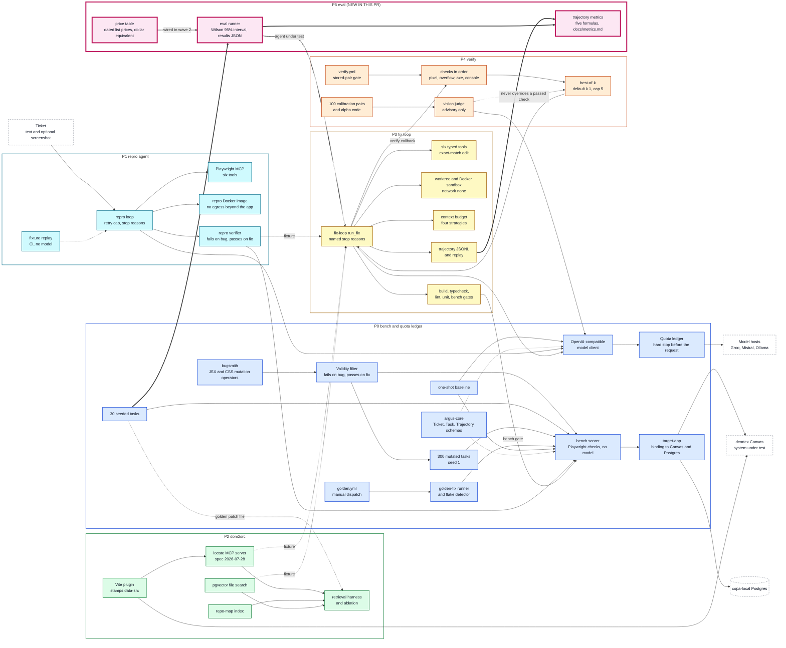

# Architecture overview (P0 to P5)

As-built view of Argus after phase P5 (so far). Later phases are not drawn. This file grows by one phase in each stacked pull request; the diagram source is the same text the PR description shows.

## How to read it

| Mark | Meaning |
|---|---|
| Thick border, box labelled `NEW IN THIS PR` | the part this phase adds |
| Thin border | an earlier phase |
| Dashed white box | a system outside this repo (Canvas, Postgres, model hosts, the ticket) |
| Dotted arrow | a stored input (`fixture`), a test-only link or an advisory link, not a live call |
| Thick arrow | a link added in this phase |

Colours: P0 blue, P1 cyan, P2 green, P3 yellow, P4 orange, P5 pink.

## What P5 adds (so far)

- `packages/eval`: the five trajectory metrics (steps, tool-error rate, redundant-call rate, stuck rate, recover-after-gate-failure rate) over stored trajectory files, and a runner that writes one results JSON with a Wilson 95% interval. The results JSON is the file the report, gate and dashboard read.
- `packages/argus-core/prices.json`: dated list prices per model and the dollar-equivalent function. Not wired into results yet.
- Per-task detail: `docs/architecture/p5.md`.

## What P4 added

- `packages/verify`: four fixed checks in a fixed order (pixel, overflow, axe, console); a hard failure returns one verdict and stops.
- A vision judge that is advisory only and never overrides a passing check run.
- Best-of-k selection (default k = 1, cap 5), the Krippendorff-alpha code and a CI gate on a stored before/after pair (`verify.yml`).
- 100 calibration pairs of real Canvas screenshots with blank human labels, and the best-of-k runs `packages/fix-loop/runs/p4-t20-*`.

## Earlier phases

- **P0 bench and quota ledger:** `packages/bench`: 30 seeded and 300 generated bug tasks, and the scorer that runs a task's Playwright checks against a copy of Canvas with no model call.
- **P1 repro agent:** `packages/repro-agent`: a loop that asks a model for a Playwright script, runs it, revises on error and stops at a cap with a named stop reason.
- **P2 dom2src:** `packages/dom2src-plugin`: a Vite plugin that stamps `data-src="file:line:col"` on elements in dev and test builds.
- **P3 fix loop:** `packages/fix-loop`: six typed tools (no write-file; an edit must match exactly once) and a loop with named stop reasons.

## Sources

Built from `PLAN.md` (Architecture) and, where they exist, the `docs/architecture/pN.md` "As built" sections. Edges not stated word for word there: `RVERIFY --> SCORER` (the verifier runs a script on a task's buggy and golden trees); `SEEDED -.-> ABL` (retrievers are scored by the golden patch's file); `GATES --> SCORER` (the `bench` gate); `BOK --> FIX` (best-of-k picks among fix-loop candidates, `phases/P04-verify.md` T19).
