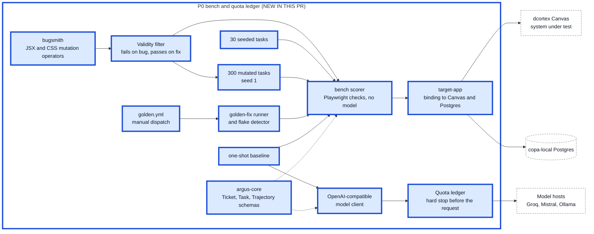

# Architecture overview (P0)

As-built view of Argus after phase P0. Later phases are not drawn. This file grows by one phase in each stacked pull request; the diagram source is the same text the PR description shows.

## How to read it

| Mark | Meaning |
|---|---|
| Thick border, box labelled `NEW IN THIS PR` | the part this phase adds |
| Thin border | an earlier phase |
| Dashed white box | a system outside this repo (Canvas, Postgres, model hosts, the ticket) |
| Dotted arrow | a stored input (`fixture`), a test-only link or an advisory link, not a live call |
| Thick arrow | a link added in this phase |

Colours: P0 blue, P1 cyan, P2 green, P3 yellow, P4 orange.

## What P0 adds

- `packages/bench`: 30 seeded and 300 generated bug tasks, and the scorer that runs a task's Playwright checks against a copy of Canvas with no model call.
- `packages/bugsmith`: breaks the UI on purpose (JSX and CSS rules); a generated bug is kept only if the checks fail on it and pass on the original.
- A flake detector (repeat runs, quarantine on disagreement) and the golden-fix runner.
- `packages/argus-core`: the Ticket, Task and Trajectory schemas, the OpenAI-compatible model client and the quota ledger that refuses a call before any request is sent.
- `packages/target-app`: the binding to Canvas and Postgres. `golden.yml` is a manual workflow because the Canvas repo is private.

## Sources

Built from `PLAN.md` (Architecture) and, where they exist, the `docs/architecture/pN.md` "As built" sections.
