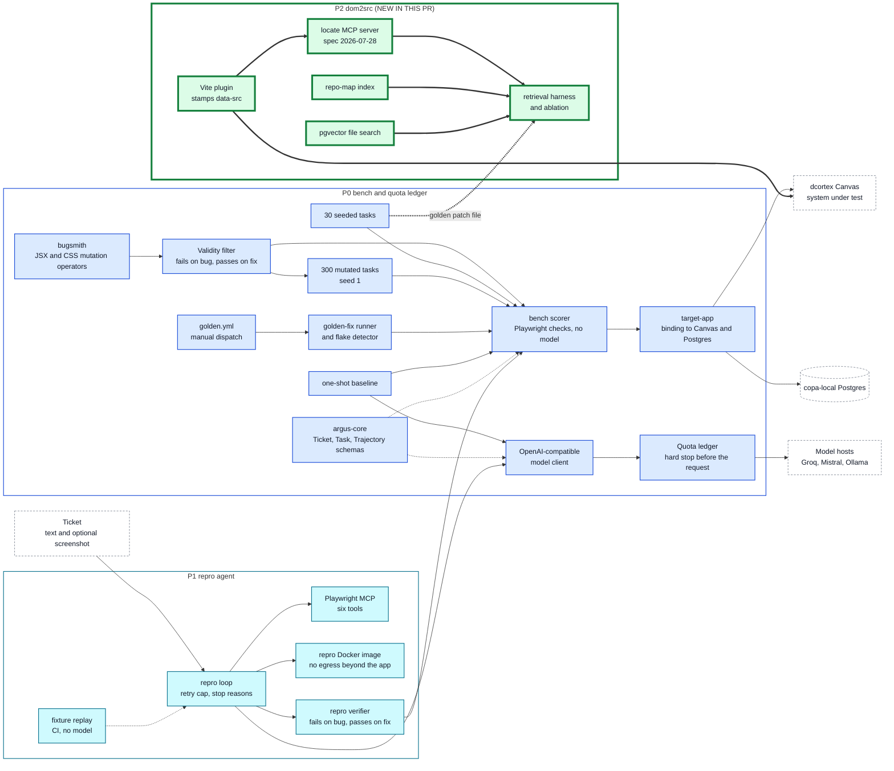

# Architecture overview (P0 to P2)

As-built view of Argus after phase P2. Later phases are not drawn. This file grows by one phase in each stacked pull request; the diagram source is the same text the PR description shows.

## How to read it

| Mark | Meaning |
|---|---|
| Thick border, box labelled `NEW IN THIS PR` | the part this phase adds |
| Thin border | an earlier phase |
| Dashed white box | a system outside this repo (Canvas, Postgres, model hosts, the ticket) |
| Dotted arrow | a stored input (`fixture`), a test-only link or an advisory link, not a live call |
| Thick arrow | a link added in this phase |

Colours: P0 blue, P1 cyan, P2 green, P3 yellow, P4 orange.

## What P2 adds

- `packages/dom2src-plugin`: a Vite plugin that stamps `data-src="file:line:col"` on elements in dev and test builds.
- `packages/dom2src-mcp`: `locate(selector, html)` as an MCP server, a symbol repo-map and local pgvector search over Canvas files.
- A harness that scores each retriever by the file in the golden patch, and an ablation over the 30 seeded tasks.

## Earlier phases

- **P0 bench and quota ledger:** `packages/bench`: 30 seeded and 300 generated bug tasks, and the scorer that runs a task's Playwright checks against a copy of Canvas with no model call.
- **P1 repro agent:** `packages/repro-agent`: a loop that asks a model for a Playwright script, runs it, revises on error and stops at a cap with a named stop reason.

## Sources

Built from `PLAN.md` (Architecture) and, where they exist, the `docs/architecture/pN.md` "As built" sections. Edges not stated word for word there: `RVERIFY --> SCORER` (the verifier runs a script on a task's buggy and golden trees); `SEEDED -.-> ABL` (retrievers are scored by the golden patch's file).
