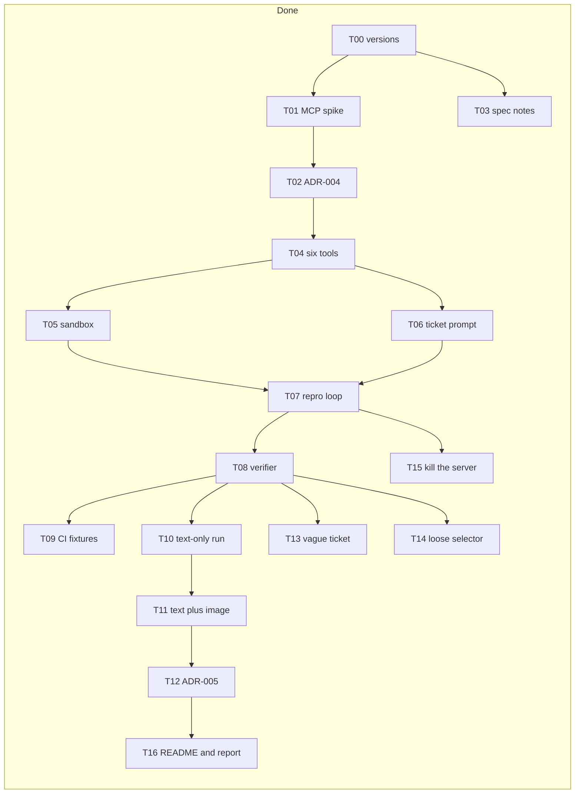
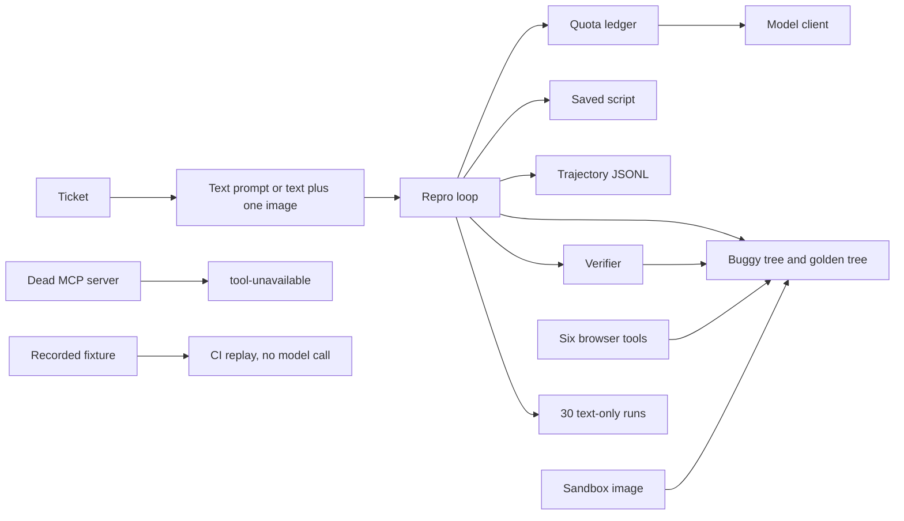

# P1 architecture

This file grows as P1 tasks land. A wave is a set of tasks that do not depend on each other, so they can run at the same time. The next wave starts only when the tasks it depends on are done. The phase table lists dependencies. It does not name the waves. This is that split.

## Waves

Parallel sets:

- Wave 1: T00.
- Wave 2: T01 and T03.
- Wave 3: T02.
- Wave 4: T04.
- Wave 5: T05 and T06.
- Wave 6: T07.
- Wave 7: T08 and T15. Done.
- Wave 8: T09, T10, T13, and T14. Done. T15 does not block these.
- Wave 9: T11. Done.
- Wave 10: T12. Done.
- Wave 11: T16. Done. P1 is complete.

## As built

- **Six tools (T04).** navigate, snapshot, click, type, assert-visible, screenshot. `browser_run_code_unsafe` and `page.evaluate` stay off. assert-visible is a role plus an accessible name. `stale-target` and `not-unique` are typed errors. A snapshot takes a depth or a byte cap. Refs may look like `e5` or `f2e2`.
- **Sandbox (T05).** `argus-repro:p1` runs a Playwright script on an internal Docker network. It can reach the app container and cannot open `1.1.1.1:443`. Each start gets its own user-data directory.
- **Ticket prompt (T06).** Text mode has no image. Image mode attaches the screenshot only after the bytes match the declared media type. A mismatch is a tool error and is not sent to the model.
- **Repro loop (T07).** The loop asks the model for a script, then asks `run_trees` how that script behaved. It stops with `submit` when the script fails on the buggy tree and passes on the golden tree. It stops with `retry-cap` when the cap is hit. An empty reply counts toward that cap. It stops with `QuotaExceeded` when the ledger refuses the call, and the model is not called. The saved script uses `getByRole` and the accessible name, includes a symptom assertion, and does not keep a snapshot ref. One `trajectory.jsonl` per run validates as a Trajectory. The tree runner is injected: a real run supplies the sandbox, and the loop does not start Docker itself.
- **Verifier (T08).** A script is `valid` when it fails on the buggy tree and passes on the golden tree. `passes-on-bug` means it passed on the bug. `fails-on-golden` means it did not pass on the fix. `test.skip` or `test.fixme` is `error` even if both trees would pass. Four hand-made scripts, run in the sandbox image, cover those verdicts.
- **Dead server (T15).** If the Playwright MCP process dies during a call, or it is already gone when the next call starts, the browser restarts once. If that restart does not recover the call, the loop stops with `tool-unavailable`. A call that does not return is the same stop, and it is cut off at the tool timeout. Direct Playwright is not started.
- **Fixture replay (T09).** `.github/workflows/repro.yml` runs on push. It has no secrets. Replaying `fixtures/replay/sign-in` through the loop, with the recorded reply and no model call, returns the stored trajectory.
- **Text-only batch (T10).** `runs/text-only/` has one verdict and one trajectory for each of the 30 seeded tasks. Mode is text, so the screenshot on BUG-17 is not attached. The ledger recorded 30 calls for `openai/gpt-oss-20b`, inside the measured daily and per-minute caps. The replies are recorded in the runner (`host` is `fixture`), so this pass does not call a provider. `seed-e01` dies with `tool-unavailable`, and `seed-e02` still gets a verdict.
- **Vague ticket (T13).** Ticket text `the page looks wrong`, with no route and no element. Two empty replies hit `retry-cap`. The last trajectory step carries that stop. No script is saved.
- **Loose selector (T14).** A script that only asserts the Sign in heading passes on both trees. The verifier returns `passes-on-bug`.
- **Text plus image (T11).** `runs/text-plus-image/` has the same 30 tasks, the same model, and the same verdicts as the text-only batch. The BUG-17 PNG is attached once. The other tickets have no image.
- **Screenshot rule (T12).** ADR-005 keeps text as the default. The ablation rows match, so the image bytes did not buy a verdict.
- **Phase close (T16).** The README shows `uv run --package repro-agent python -m repro_agent.batch text-only` and the same command with `text-plus-image`. The phase report uses the P0 baseline as the previous row and the text-only batch as this phase. Both P1 batches are fixture replay (`host` is `fixture`), so 28/30 is not a live-model result.
