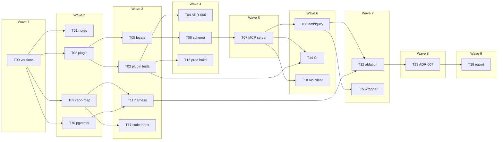

# P2 architecture

This file grows as P2 tasks land. A wave is a set of tasks that do not depend on each other, so they can run at the same time. The next wave starts only when the tasks it depends on are done. The phase table lists dependencies. It does not name the waves. This is that split.

Source: `phases/P02-dom2src.md`. P1-T16 is done. P0-T09 is done. The plan below is the design as written before the work; the "As built" section at the end records what was built and what was not.

The long chain is T00, T02, T05, T06, T07, T08, T12, T13, T19. That is nine waves. The repo-map lane (T09, T10, T11, T17) joins that chain at the ablation.

## Waves

Parallel sets:

- Wave 1: T00. Done.
- Wave 2: T01, T02, T09, and T10. T02 also needs P0-T09, which is done.
- Wave 3: T03, T05, T11, and T17. Done.
- Wave 4: T04, T06, and T16. Done.
- Wave 5: T07. Done.
- Wave 6: T08, T14, and T18. Done. T07 and T03 are done.
- Wave 7: T12 and T15. Done.
- Wave 8: T13. Done.
- Wave 9: T19. Done.

## File lanes

Tasks in one wave do not edit the same files. The parent owns `TASKS.md`, this file, `PLAN.md`, `PROJECT.md`, `pyproject.toml`, and `pnpm-workspace.yaml`.

- T00: version tables in `PLAN.md` and `PROJECT.md` only.
- T01: `docs/notes/p2-dom-grounding.md` only.
- T02: `packages/dom2src-plugin/**` only. The plugin is applied to the dcortex Canvas worktree named in `config/platform.md`. It does not vendor Canvas and it does not edit that repo's source.
- T09: `packages/dom2src-mcp/src/dom2src_mcp/repo_map.py` and `packages/dom2src-mcp/index.json` only, after the package skeleton exists.
- T10: `packages/dom2src-mcp/src/dom2src_mcp/embed.py` only. Its Postgres is local and offline. It is not the copa-local database on port 5433.
- Later waves keep `locate()` in `packages/dom2src-mcp/` and the Playwright attribute tests next to the plugin.
- T03: `packages/dom2src-plugin/**` only. Do not edit the dcortex checkout.
- T05: `packages/dom2src-mcp/src/dom2src_mcp/locate.py` and `packages/dom2src-mcp/tests/test_locate.py` only.
- T17: `packages/dom2src-mcp/src/dom2src_mcp/repo_map.py`, `packages/dom2src-mcp/tests/test_repo_map.py`, and the P2-T17 paragraph in `phases/P02-dom2src.md`. Do not rewrite `index.json`.
- T04: `docs/adr/0006-data-src-vs-source-maps.md` only.
- T06: `packages/dom2src-mcp/schemas/locate.schema.json`, `packages/dom2src-mcp/schemas/locate.examples.json`, and `packages/dom2src-mcp/tests/test_locate_schema.py` only.
- T16: `packages/dom2src-mcp/src/dom2src_mcp/locate.py`, `packages/dom2src-mcp/tests/test_locate.py`, and the P2-T16 paragraph in `phases/P02-dom2src.md`.
- T07: `packages/dom2src-mcp/src/dom2src_mcp/server.py` and `packages/dom2src-mcp/tests/test_server.py` only. `mcp==2.3.0` is already declared on the package.
- T08: `packages/dom2src-mcp/src/dom2src_mcp/locate.py` and `packages/dom2src-mcp/tests/test_locate.py` only.
- T14: `.github/workflows/dom2src.yml` only.
- T18: `packages/dom2src-mcp/src/dom2src_mcp/server.py`, `packages/dom2src-mcp/tests/test_old_client.py`, and the P2-T18 paragraph in `phases/P02-dom2src.md`. Do not change `_result` or the locate tool body.
- T15: the P2-T15 paragraph in `phases/P02-dom2src.md` only. `locate()` already returns both candidates.
- T11: `packages/dom2src-mcp/src/dom2src_mcp/harness.py` and `packages/dom2src-mcp/tests/test_harness.py` only. Do not fill the ablation table. Do not call the live retrievers in the test.

## As built

- **Versions (T00).** Re-checked 2026-10-30. The pinned rows are unchanged. The Playwright `next` tag is `1.65.0-alpha-2026-10-30` and stays off those rows. Babel's `sourceSelf` option still says `__source` and `__self` were removed from `jsxDEV` in React 19.2. The React 19.3 blog does not mention `jsxDEV` or `_debugSource`.
- **Notes (T01).** `docs/notes/p2-dom-grounding.md`. React 19 removed `_debugSource` from Fiber nodes. `_debugStack` does not yield a filesystem path, so the Vite plugin stamps `data-src` at build time. Aider ranks files by a dependency graph and keeps the most referenced parts that fit the token budget. The issue HTML page timed out; the note uses the GitHub API for that issue.
- **Repo-map (T09).** `index.json` lists symbols for `apps/canvas/src` in the platform worktree: 395 files, tsserver 5.8.3. `query("UserAdmin")` returns definition and reference locations from that server. `typescript-language-server` is not installed.
- **Stale index (T17).** `query` raises `StaleIndex` when a named file's sha256 no longer matches `content_hashes`. The check ran on a temp file, `apps/canvas/src/Widget.tsx`. The committed `index.json` was rebuilt with `content_hashes` for all 395 files (hashed with CRLF normalised, so a Windows and a Linux checkout agree), and `test_committed_index_is_checked_for_staleness` fails if the hashes are missing or the index is not checked.
- **Plugin (T02).** `@argus/dom2src-plugin` stamps `data-src="file:line:col"` on JSX host elements in development and test, and skips production. `enforce` is `pre`. The unit test transforms the five Canvas flow files in memory. It does not edit `apps/canvas/vite.config.ts`, and no dcortex dev server was started. T03 registers the plugin before `react()` when it runs the Playwright counts.
- **locate (T05).** `locate(selector, html)` reads `data-src` on the first `#id` or `[data-testid]` match and returns file, line, and column. A missing selector is `NotFound` with `error="not-found"`.
- **Ambiguous locate (T08).** A wrapper button returns `Ambiguous`. Rank 1 is the ancestor call site (`Page.tsx:8`), rank 2 is the definition (`Button.tsx:4`). Two elements with the same `data-testid` return one candidate each, in document order. A single sourced node with no different ancestor stays `Location`. The locate tests passed 32. Over MCP, `_result` returns the ranked candidates in `structured_content` with `is_error` true; a stdio client test (`test_server.py`) covers the wrapper button.
- **Production locate (T16).** A matched node with no `data-src` returns `NoSourceInfo` (`no-source-info`) and no file or line. A selector that matches nothing stays `NotFound`. The locate tests, including that production HTML, passed 28.
- **Schema (T06).** `packages/dom2src-mcp/schemas/locate.schema.json` validates input, success output, and errors. The error codes are `not-found`, `ambiguous` (with `candidates`: file, line, col, rank), `no-source-info`, and `unsupported-selector`. Examples of each pass. An error example does not carry a guessed file.
- **MCP server (T07).** stdio server `dom2src`. `SPEC_VERSION` is `2026-07-28`. A client in that mode negotiated `2026-07-28` and one `locate` call for `#sign-in` returned `apps/canvas/src/screens/Landing.tsx` line 40. The HTML document is `--html-file`. The tool argument is the selector only.
- **CI (T14).** `.github/workflows/dom2src.yml` runs on push. No secrets. It runs `uv sync --all-packages --locked`, `pnpm install --frozen-lockfile`, `pytest packages/dom2src-mcp/tests -m "not live"`, the plugin's `transform.test.ts`, then the Playwright attribute test after `playwright install chromium`. The `live` tests need the private platform checkout and the local pgvector container, so CI skips them. The same commands were run locally (see `docs/notes/p2-conformance-fixes.md`). The workflow has not been pushed, so GitHub has not run it, and P2-T14 stays unticked until a green run id exists.
- **Older client (T18).** Initialize middleware accepts only `2026-07-28`. A client in mode `legacy` that offers `2025-11-25` gets `MCPError` (`protocol versions do not match: client 2025-11-25, server 2026-07-28`) and does not hang. Re-ran `test_old_client.py` and `test_server.py`: 2 passed. The current client still completes one `locate()` call.
- **Wrapper (T15).** `locate("#save")` on a button stamped `Button.tsx:4:3` inside a host stamped `Page.tsx:8:5` returns `ambiguous`. Rank 1 is the call site. Rank 2 is the wrapper definition. The wrapper test passed 1.
- **Attribute tests (T03).** Playwright on a Vite fixture in the plugin package, not the dcortex dev server. Dev mode: 5 host elements, 0 missing `data-src`. Production build: 0 elements with `data-src`. `dom2srcPlugin()` is listed before `react()`. The dcortex checkout was not edited.
- **ADR-006 (T04).** `docs/adr/0006-data-src-vs-source-maps.md`. The build-time `data-src` attribute is the DOM-to-source route. Source maps stay with the generated code and are not on the DOM node. Production builds do not emit the attribute.
- **pgvector (T10).** `embed.py` indexes the scoped Canvas files into Postgres `canvas_embed` on port 5436 with `all-MiniLM-L6-v2` on CPU. Re-ran `test_embed.py`: 3 passed. The database holds 79 files, 854 chunks, 384-dimensional vectors. A line from `AuditLog.tsx` and a line from `UserAdmin.tsx` each ranked that file first. The test refuses port 5433, `copa_local`, and `db-copa-local`.
- **Harness (T11).** `score(tasks, retriever)` reads `+++ b/` paths from each task's `golden.patch` and prints top-1 and top-3 with the existing Wilson 95% label. A stub that places the golden file at ranks 1, 2, and 4 prints `top-1 1/3 [0.061490, 0.792345] top-3 2/3 [0.207655, 0.938510]`. Re-ran `test_harness.py`: 2 passed.
- **Ablation (T12).** The 30 seeded tasks, 10 per tier. Repo-map top-1 0/30 [0.000000, 0.113517]. pgvector top-1 15/30 [0.331539, 0.668461], top-3 19/30. `locate()` top-1 0/30 because no task had a supported selector and an HTML file. No LLM call. The table is in `phases/P02-dom2src.md`.
- **ADR-007 (T13).** `docs/adr/0007-retrieval-strategy.md`. For a prose ticket with no DOM, pgvector is the default. `locate()` is the fallback when a selector and stamped HTML are present. Repo-map is not the file ranker for these CSS bugs.
- **READMEs and phase report (T19).** Both package READMEs show install and run commands. The phase-report previous row is P1's 28/30 text-only batch. This phase does not report a bug-resolve rate. Its latency cells are the pgvector per-task times, p50 0.822504s and p95 2.906274s.
