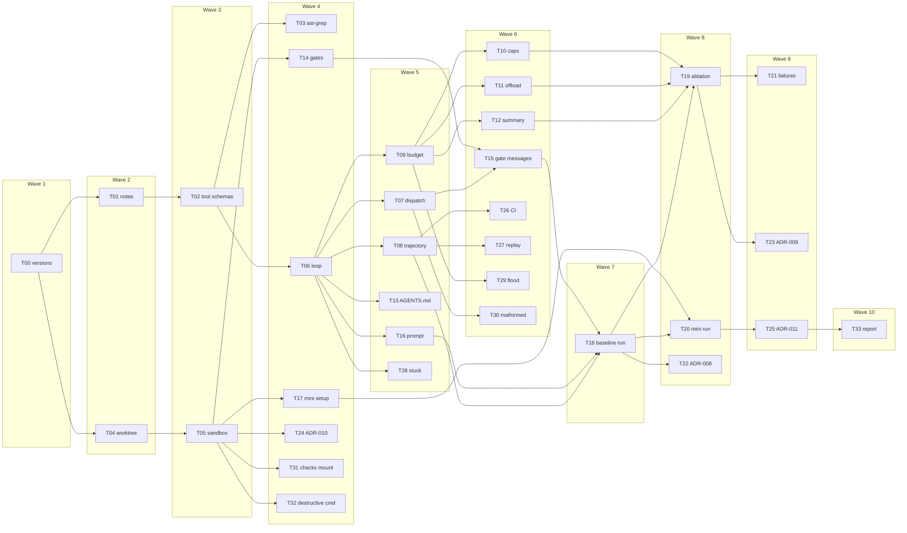

# P3 architecture

This file grows as P3 tasks land. A wave is a set of tasks that do not depend on each other, so they can run at the same time. The next wave starts only when the tasks it depends on are done. The phase table lists dependencies. It does not name the waves. This is that split.

Source: `phases/P03-fix-loop.md`. P2-T19 is done. Wave 3 is done.

The long chain is T00, T01, T02, T06, T07, T15, T18, T20, T25, T33. That is ten waves. The sandbox lane (T04, T05) joins the loop at the gates. The context lane (T09 through T12) joins at the ablation.

## Waves

Parallel sets:

- Wave 1: T00. Done.
- Wave 2: T01 and T04. Done.
- Wave 3: T02 and T05. Done.
- Wave 4: T03, T06, T14, T24, T31, and T32 done. T17 is not started. It needs a live mini-swe-agent run and the OpenAI-compatible endpoint.
- Wave 5: T07, T08, T09, T13, T16, and T28. Done. T17 is still open and does not block these.
- Wave 6: T10, T11, T12, T15, T26, T27, T29, and T30. Done. T17 is still open.
- Wave 7: T18. The runner is in place. The live 30-task run is not. The fixer still has no key, and the ablation cell stays empty.
- Wave 8: T22 done. T19 and T20 are not run. Both need the live baseline, and T20 also needs mini-swe-agent.
- Wave 9: T25 done. T21 and T23 are not written. Both need the ablation rows, which are still empty.
- Wave 10: T33 is not done. The README lists `fix-loop replay` and the run entry point. The phase report's previous row is P2. This phase's cells stay `—` because the fixer run has not been made.
- Later waves stay in `packages/fix-loop/` except the notes, the ADRs, `AGENTS.md` for the dcortex worktree, and the CI workflow.

## File lanes

Tasks in one wave do not edit the same files. The parent owns `TASKS.md`, this file, `PLAN.md`, `PROJECT.md`, and `pyproject.toml`.

- T00: version tables in `PLAN.md` and `PROJECT.md` only.
- T01: `docs/notes/p3-loop-design.md` only.
- T04: `packages/fix-loop/**` for the worktree manager, plus the `packages/fix-loop` line in the workspace members list. It does not mount Docker and it does not call a model.
- T02: tool schema files and one unit test per tool, under `packages/fix-loop/`. `edit` is an exact unique match. No whitespace flex, no fuzzy matcher, and no second whole-file tool.
- T05: the Docker sandbox runner under `packages/fix-loop/`. Checks are mounted read-only. `--network none`.
- T03: `ast_grep` in `tools.py`, its schema, and `tests/test_ast_grep.py`. It shells out to `@ast-grep/cli@0.51.0`. No new Python dependency.
- T06: `loop.py` and `tests/test_loop.py`. The caller passes `execute` when `run_cmd` must go through the sandbox. The default `execute` is `tools.call`.
- T14: `gates.py` and `tests/test_gates.py`. The unit test injects commands. It does not run the Canvas npm scripts.
- T24: `docs/adr/0010-sandbox-baseline.md` only.
- T31 and T32: `tests/test_break_sandbox.py` and the Observed lines in `phases/P03-fix-loop.md`. They do not change the sandbox flags.
- T17: not started. The mini adapter is its file. It does not rewrite the loop stop list.
- T07: `tests/test_dispatch.py`. Dispatch stays `tools.call`. Five bad inputs, including a non-unique `edit`, return a typed error and do not raise.
- T08: `tests/test_trajectory.py`. The loop's JSONL is validated against `packages/argus-core/schemas/trajectory.schema.json`. A rejected call keeps `raw_response`.
- T09: `budget.py` and `tests/test_budget.py`. `run_fix` calls it only when `context_budget` and `strategy` are passed. The four strategies are still T10, T11, and T12.
- T13: `packages/fix-loop/AGENTS.md` and `prompt.system_message`. It is not written into the dcortex checkout.
- T16: `fixtures/bug-17.json` and `prompt.user_message`.
- T28: the Observed line on break-it item 1 in `phases/P03-fix-loop.md`. The stuck behavior is the T06 test.
- T10, T11, T12: `strategies.py` and `tests/test_strategies.py`. The cap is 8000 characters and the offload head is 200. The phase did not set those integers.
- T15: `gate_message` and the `gates` argument on `run_fix`. `tests/test_gates_loop.py`.
- T26: `.github/workflows/fix-loop.yml` and `frameworks.py`. The job skips the Docker and ast-grep tests.
- T27: `replay.py` and `fix-loop replay <file>`. `tests/test_replay.py`.
- T29 and T30: `tests/test_break_context.py` and the Observed lines on break-it items 2 and 3.
- T18: `baseline.py` and `tests/test_baseline.py`. It does not call a provider and it does not fill the ablation table.
- T22: `docs/adr/0008-loop-control.md` only, plus the scoring assertion in `tests/test_baseline.py`.
- T25: `docs/adr/0011-framework-adoption.md` only. The ablation table is not filled.
- T33: `packages/fix-loop/README.md` commands, and the previous-phase row in `phases/P03-fix-loop.md`. The this-phase row is not filled.

## As built

- **Versions (T00).** Re-checked 2026-10-31. The pinned rows are unchanged. The Playwright `next` tag is still `1.65.0-alpha-2026-10-30` and stays off those rows. Babel's `sourceSelf` option still says `__source` and `__self` were removed from `jsxDEV` in React 19.2. The React 19.3 blog does not mention `jsxDEV` or `_debugSource`. The fixer cards name `devstral-2512` and `labs-devstral-small-2512`. Both say deprecated. The usage-limits page publishes no numeric free-tier cap. `docs/quotas.md` still has no Mistral row. The fixer row in the plan is unchanged until a callable host is chosen.
- **Notes (T01).** `docs/notes/p3-loop-design.md`. Read mini-swe-agent at `04d809ceab9df28f9adaed044884180159172930` and the Anthropic context-engineering post (2025-09-29). Mini's loop is query then execute until an exit message. Its only tool is `bash`. It finishes when stdout starts with `COMPLETE_TASK_AND_SUBMIT_FINAL_OUTPUT`. Stops are a dollar cap (default 3.0), a step cap that is off when the limit is 0, wall time, and three format errors. Observations of 10000 characters or more keep a 5000-character head and tail. The three different choices are typed tools with `submit`, the P3 stop list, and the four context strategies.
- **Worktree (T04).** `create(repo, task_id, commit, root=...)` runs `git worktree add --detach` at `commit`. `destroy` runs `git worktree remove --force` and checks `git worktree list`. The test uses a temporary repo: the worktree HEAD is the first commit, its status is empty, the main tree stays dirty, and destroy drops the path from the list. Re-ran `packages/fix-loop/tests/test_worktree.py`: 2 passed. The package is a workspace member. It does not call a model and it does not start Docker.
- **Tools (T02).** Six tools in `packages/fix-loop/src/fix_loop/tools.py`. Schemas are in `packages/fix-loop/schemas/`. `edit` replaces one exact occurrence. Two matches of `alpha` return `not-unique` with message `a.txt matches lines 1, 3`, and the file is unchanged. `a b` does not match `a  b`. `read_file` and `edit` return `outside-worktree` for `../secret.txt`. There is no `write_file`. Re-ran `packages/fix-loop/tests/test_tools.py`: 7 passed. The host-filesystem probe stays P7-T12.
- **Sandbox (T05).** `run` uses image `argus-fix-sandbox:p3` (local `alpine` digest `sha256:294b683cb724975bec92580e1e685676bd4b50bda910ddb8c51d4cabeaec77e6`), `--network none`, `--cpus 1`, `--memory 512m`. The worktree is mounted at `/work`. Checks are mounted at `/checks:ro`. The test creates a worktree with T04, then `wget` to example.com fails, a write to `/checks/keep.txt` fails and the file stays `same`, and a write to `/work/note.txt` succeeds. Re-ran `packages/fix-loop/tests/test_sandbox.py`: 1 passed.
- **ast-grep (T03).** `ast_grep` runs `npx --yes -p @ast-grep/cli@0.51.0 ast-grep run` with `--json=compact`. Lines in the JSON are 0-based and the tool reports them 1-based. `import $NAME from $SRC` on `apps/canvas/src/main.tsx` returns `src/main.tsx:1`. A pattern whose stderr contains `ERROR node` is `bad-pattern`. The path is confined to the root passed to `call`. Re-ran `packages/fix-loop/tests/test_ast_grep.py`: 1 passed.
- **Loop (T06).** `run_fix` takes an injected `complete` and an optional `execute`. It does not extend `ModelClient`. Stops are `submit`, `step-cap`, `token-cap`, `QuotaExceeded`, `stuck`, and `consecutive-timeout`. Three identical calls are `stuck`. Three timeouts are `consecutive-timeout` even when the command is the same. A cap below 1 raises. `vim` and a bare `python` or `node` return `not-allowed` with `interactive command rejected`. `python -c` is allowed. The token cap is checked after the ledger call and before `execute`. `fix-loop` depends on `argus-core` in the workspace. Re-ran `packages/fix-loop/tests/test_loop.py`: 7 passed. The four context strategies are not in this loop.
- **Gates (T14).** `run_gates` runs `build`, `typecheck`, `lint`, `unit`, and `bench` and returns pass or fail for each. The test injects commands. A marker file that is not `ok` fails only `typecheck`. Re-ran `packages/fix-loop/tests/test_gates.py`: 1 passed. Feeding a failed gate back into the loop is T15. The test does not launch the Canvas npm scripts.
- **ADR-010 (T24).** `docs/adr/0010-sandbox-baseline.md`. Threat: the shell can touch the host checkout, overwrite a check, or use the network. Controls: disposable worktree, checks mounted read-only, `--network none`, 1 CPU, 512m. Upgrade path: gVisor, then Firecracker, measured in P7. The model call stays outside the container.
- **Checks mount (T31).** A fake model runs `echo x > /checks/keep.txt` through `sandbox.run`. The trajectory step has `tool_name` `run_cmd` and `tool_error` `failed`. `keep.txt` stays `same`. Re-ran `packages/fix-loop/tests/test_break_sandbox.py`: 2 passed, with the T32 case below.
- **Destructive command (T32).** `rm -f /work/a.txt` removes `a.txt` in the worktree. The host repo hash, excluding `.git`, is unchanged and the host file stays `one`. A gate that requires `a.txt` fails. Timeout and the interactive rejection are the loop tests above. The command was `rm -f` of the worktree file, not a wipe of the container root.
- **Dispatch (T07).** `call` returns a `ToolError` for a non-unique `edit` (`a.txt matches lines 1, 3`), a missing field, a wrong type, `write_file`, and a path outside the worktree. `a b` does not match `a  b`. The error codes do not include `stuck`. A malformed `edit` is a trajectory step with `tool_error` set and no stop reason, and the next model message contains that error. Re-ran `packages/fix-loop/tests/test_dispatch.py`: 2 passed.
- **Trajectory (T08).** One run writes `trajectory.jsonl`. `Trajectory.from_jsonl` then validates against the Trajectory schema. The rejected step stores tokens in, out, and cached, and its `raw_response` is the model text. Dropping `tokens_cached` from that line reloads as 0. Re-ran `packages/fix-loop/tests/test_trajectory.py`: 1 passed.
- **Budget (T09).** `StepUsage` reports tokens in, out, and cached. `apply_budget` calls the strategy when used tokens reach 80% of the window (`used * 100 >= budget * 80`) and leaves the messages alone below that. A fake model whose first call costs 8 tokens of a 10-token window sees the strategy's messages on the next call. No strategy is installed unless the caller passes one. Re-ran `packages/fix-loop/tests/test_budget.py`: 3 passed.
- **AGENTS.md (T13).** `packages/fix-loop/AGENTS.md` names the platform layout, the `copa-local` compose command, the Canvas npm scripts, and the tables Argus must not write. `run_fix` puts that file in the system message ahead of the instruction. Re-ran `packages/fix-loop/tests/test_agents.py`: 1 passed.
- **Prompt (T16).** `fixtures/bug-17.json` has repro `valid` and locate `apps/canvas/src/screens/Landing.tsx:40`. `user_message` puts the ticket, `Repro: valid`, and that file and line in the first user message. Re-ran `packages/fix-loop/tests/test_prompt.py`: 1 passed.
- **Stuck (T28).** The same `read_file` three times stops as `stuck` with 3 trajectory steps. Written up on break-it item 1. The check is `packages/fix-loop/tests/test_loop.py`.
- **Caps (T10).** `cap_text` keeps a prefix and drops the tail. A 50_000-character string becomes 8000 characters and ends with `[truncated]`. The phase names the 50_000-character input and does not set the cap. 8000 is the choice until ADR-009. Re-ran `packages/fix-loop/tests/test_strategies.py`.
- **Offload (T11).** A body longer than the cap is written to `.argus/obs-1.txt`. The message keeps a 200-character head and `[offloaded .argus/obs-1.txt]`. `read_file` on that path returns the body. The head length is the same kind of choice as the cap.
- **Summary (T12).** `rolling_summary` calls the model name the caller passes, through the ledger. The test uses `cheap` and does not call Groq. The system message and the first user message stay. Older turns become one `Summary:` message. There is no last-N elision. A summary that is not shorter raises `SummaryDidNotShrink`, and the loop stops with `summary`. The phase did not name that code. The trajectory schema enum now includes it.
- **Gate messages (T15).** On `submit`, a failed gate is `{"error": "...", "gate": "typecheck"}` using the first line of the gate output. The loop calls the model again. A later pass stops as `submit`. The test injects the gate result and does not run npm.
- **CI (T26).** `.github/workflows/fix-loop.yml` runs the fix-loop tests except the Docker and ast-grep files, then `python -m fix_loop.frameworks`. The checker rejects `langgraph` and accepts this package's dependencies. The workflow file has no secrets. GitHub Actions was not run from here.
- **Replay (T27).** `fix-loop replay <file>` applies stored `edit` calls and prints `git diff`. It does not run `run_cmd`. A stored `echo x > planted.txt` does not create the file. Two tool-call ids produce two observations. No model is called.
- **Flood (T29).** A 5 MB `read_file` crossed the budget. The next model message was the 8000-character cap. The run submitted and did not raise. Written up on break-it item 2.
- **Malformed (T30).** Three bad `edit` calls stop as `retry-cap`, not `stuck`. The model sees `failed: missing old`. A provider body with no `choices` is `provider payload missing choices`, and the run continues. Written up on break-it item 3.
- **Baseline runner (T18).** `seeded_subset` is the 30 seeded tasks, 10 easy, 10 medium, 10 hard, skipping `packages/bench/quarantine/` when that directory exists. `run_baseline` calls the loop with no strategy and no context budget. Exit 2 is `excluded` and stays out of the Wilson denominator. A score of 0 whose checks were touched is `unresolved`. One crashed task does not stop the next. `rate_label(0, 10)` is `0/10 [0.000000, 0.277540]`, the same z=1.96 cell as P0. Re-ran `packages/fix-loop/tests/test_baseline.py`: 6 passed. No provider was called. The 30 trajectories are not saved, and the ablation row for variant A is still `—`.
- **ADR-008 (T22).** `docs/adr/0008-loop-control.md`. The stored reply is `{"tool", "arguments"}`. `edit` is an exact unique match and the error names the lines. `REPEAT` is 3, a planning choice. A `token-cap` or `stuck` stop still scores the diff and the stop reason is not rewritten. The ablation table is not filled.
- **ADR-011 (T25).** `docs/adr/0011-framework-adoption.md`. Variant E is mini-swe-agent at `04d809ceab9df28f9adaed044884180159172930` with `src/minisweagent/config/mini.yaml`, `cost_limit` 0, `cost_tracking` `ignore_errors`, `--network none`, and interpreter `["bash", "-lc"]`. Mini scores stdout after `COMPLETE_TASK_AND_SUBMIT_FINAL_OUTPUT`. Its stops are not the Argus codes. A framework is justified only when E's Wilson 95% interval lies entirely above A's on the same 30 tasks and the same model. No resolve rate is cited, and no framework is added.
- **Report (T33, not done).** The README lists `fix-loop replay <file>`, the framework check, and the unit-test command. `run_baseline` is the run entry point and it does not call a provider. The phase report's previous row is P2: latency `0.822504s` and `2.906274s`, and the other cells `—`. This phase's row is still `—`. The P0 baseline `0/10 [-0.000000, 0.277540]` is cited and is not copied into this phase's resolve cell.
