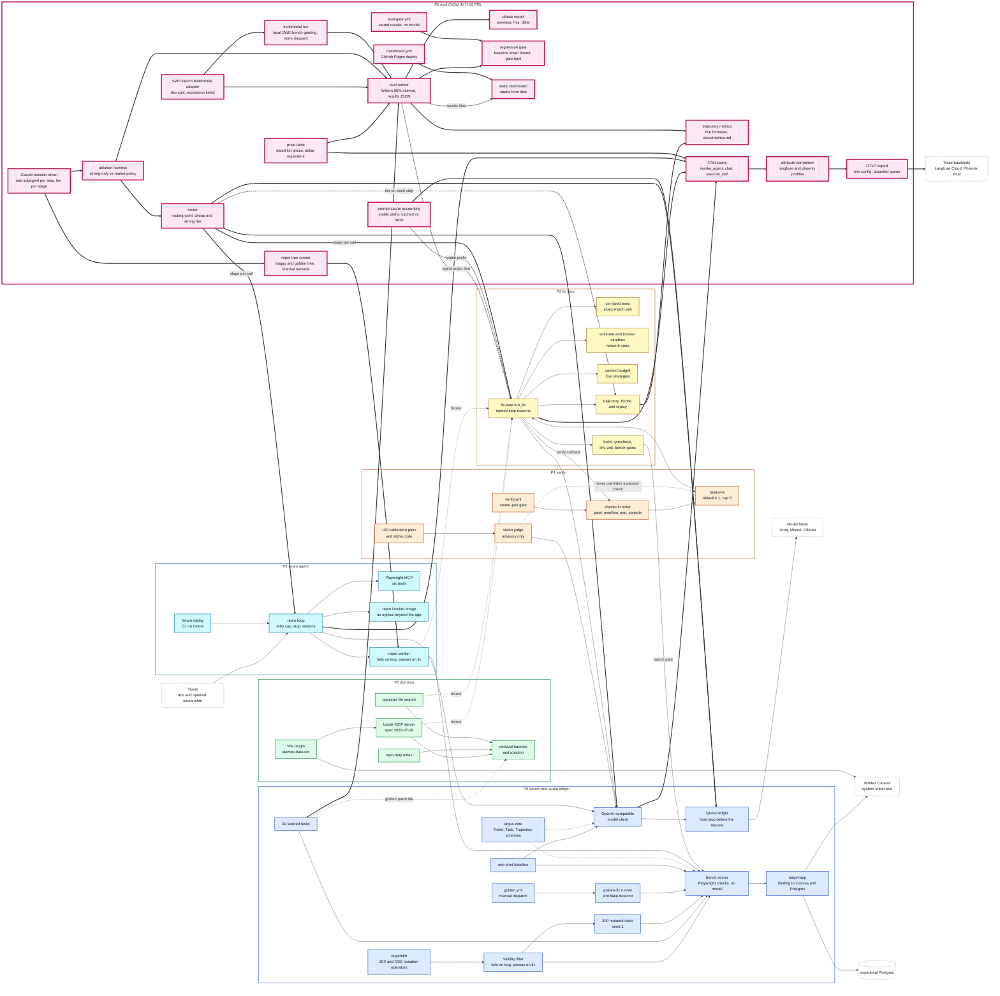

## Problem

Nothing measured the whole pipeline end to end, nothing recorded how a run got to its result, and nothing stopped a change from quietly making the fixer worse. It was also unknown whether sending the cheap steps to a cheaper model saves anything without losing fixes.

## Solution

- Five trajectory metrics (steps, tool-error rate, redundant-call rate, stuck rate, recover-after-gate-failure rate) with exact formulas, and an eval runner that writes one results file with a Wilson 95% interval, tokens, a list-price dollar equivalent and latency.
- A phase report generator, a regression gate that compares a results file with a stored baseline using intervals (all thresholds in one file, ADR-017), and a workflow that runs it on stored results with no model call.
- OpenTelemetry spans for each model call, tool call and agent run, an attribute normalizer for Langfuse and Phoenix (unknown names pass through and are counted), and OTLP export from environment variables with a bounded queue (ADR-015). The same stubbed run reached a local Phoenix and two local receivers by changing only the endpoint and the profile.
- A router with the policy as data (repro and localize on the cheap tier, fix on the strong tier, fallback on a quota refusal only; ADR-016), a dated price table, a byte-stable prompt prefix, and cached tokens counted apart from fresh ones.
- The routing ablation, run for real with Claude sessions as the model on 29 seeded tasks in two variants (58 runs), with a live repro tree runner and a turn-by-turn driver. The runs and their evidence are in their own commit.
- Break-it tests: a renamed span attribute (strict mode raises), a dead trace backend (one bounded timeout), a timestamp at the top of the prompt (cached tokens drop to zero, with a stub provider), and the fix stage on the cheap model (the gate fails). The 29 runs of the last one are in their own commit.
- A SWE-bench Multimodal dev-subset adapter (15 tasks, exclusions listed) and a local grading run: 15 of 15 reference patches resolve, and the agent run is graded (7 solved, 5 unsolved, 3 excluded or not scored).
- A static dashboard that opens from disk, and a Pages workflow for it.

## Results

| Run (same 29 seeded tasks, Claude sessions as the model) | Resolved (95% interval) | Tokens/bug | List-price $/bug |
|---|---|---|---|
| A, every stage on the strong model | 19 of 27 (51.5% to 84.1%) | 38,757 | $0.0819 |
| B, repro on the cheap model, fix on the strong one | 20 of 28 (52.9% to 84.7%) | 34,939 | $0.0694 |
| C (break-it), fix stage on the cheap model | 13 of 29 (28.4% to 62.5%) | 56,687 | $0.0059 |

- A and B are not distinguishable (paired on 27 tasks: 18 both, 7 neither, 1 each way). The cheap tier carried about 2% of B's tokens, because the repro stage found a repro in 1 of 58 runs and localize makes no model call.
- The gate exits 1 on C against the stored baseline (20 of 29) and exits 0 on A and B. C lost 7 tasks that B resolved and gained none.

## Architecture (HLD)

The diagram shows every phase up to and including this one. This phase's part has a thick border and is labelled `NEW IN THIS PR`; thick arrows are links added here. The same source is committed as `docs/architecture/overview.md`; the design grew task by task in `docs/architecture/p5.md`.

## Stack

- Base branch: `main` (it already holds P0 to P4: PRs #4 and #5 were merged, and #6 to #8 were merged into `stack/base` and `main` by the merge commit d4e514b). Head branch: `stack/p5-eval`, cut from the P4 tip. Previous PRs: #8, #7, #6.
- Next PR: none yet (P5.5 onward not started). PR #10 (extras) is separate and untouched.
- Size: 643 files, about 18780 added lines, about 15 MB. The run evidence (`packages/eval/results/t14/`, 522 files, 13.2 MB) is in two commits of its own so reviewers can skip it.
- Commits are one per task, in plain language, with bullet points. Each wave of tasks ran as parallel sessions and was merged with a merge commit.

## Tests

| Command | Result |
|---|---|
| `uv lock --check`, `uv sync --all-packages --locked` | passed |
| `uv run pytest packages/eval/tests -q` | **70 passed** |
| `uv run pytest packages/argus-core/tests -q` | **78 passed** |
| `uv run pytest packages/fix-loop/tests -q` | **64 passed, 1 failed**: `test_ast_grep` fails the same way on `stack/p4-verify`, before any P5 change |
| `repro-agent`, `dom2src-mcp`, `verify`, `dashboard` tests | **38**, **51**, **47**, **3 passed** (docker and live tests deselected) |
| `python -m eval gate` on the baseline, A and B | exit 0; on the break-it run C and on `fixtures/gate/worse.json`: exit 1 |
| `.github/workflows/check_no_secrets.py` | only `golden.yml` is flagged, as before P5 |
| GitHub Actions on push | `eval-gate`, `verify`, `repro`, `dom2src` pass; `fix-loop` fails on `ModuleNotFoundError: jsonschema` in `test_trajectory.py` and `test_verify_gate.py`, the same import error as on the P3 and P4 PRs (an undeclared test dependency, not changed here) |

## Out of scope

- P5.5 (skills), P6 (flow), P7 (guard), P8 (app) and the backend lane.
- A routing ablation on Groq or Mistral: the free tiers are too small (about 13 days for both variants) and Mistral has no key.
- Making the harness replay deterministic under load (below).

## What this PR does not claim

- **Only a smoke trace has been seen in Langfuse** (P5-T07 is ticked on that; P5-T23 is not). The owner ran `python -m argus_core.telemetry` against a Langfuse Hobby project (US region) on 2026-11-02 and saw one trace: `invoke_agent argus-smoke` with a `chat` (generation) and a tool child. No trace of a real fix-loop run has been sent yet, so there is no real-run trace screenshot or project link. A real Phoenix 21.0.0 received the same stubbed run earlier. Details: `docs/notes/p5-t07.md`.
- **The Pages deploy has not run** (P5-T22): Pages is switched on, but GitHub only runs a workflow from the default branch, and the `github-pages` environment accepts deploys from `main` only, so `dashboard.yml` first runs when this PR is merged. The repo is private, so whether the page URL is public depends on the plan. Steps: `docs/notes/p5-t22.md`. The `eval-gate` workflow was seen on GitHub (P5-T17): green on this branch, and red on a temporary branch that carried the deliberately worse results file (run 41395983193, since deleted).
- **P5-T14 is unticked**: quota share is a dash (Claude sessions have only a self-imposed cap) and latency is not comparable between variants. Whether a Claude-session run meets the task is the owner's call.
- **P5-T20 is unticked**: the multimodal agent was one plain Claude subagent per task, one draw each, not the argus pipeline, and the agents did not run the repo tests. Two Chart.js tasks timed out in the grader on both tries (patch produced, not scored).
- **P5-T28 is unticked**: it needs the dashboard and Langfuse links from T23. The phase report against P4 is filled, but its two rows are not the same method (stateful P3 baseline against stateless Claude-session turns), so the +2.5 point resolve-rate delta means no change and the token delta is shown as not comparable.
- One run per cell, one model family, tiers set by a subagent parameter. Tokens are chars/4 estimates that leave out harness overhead. Not comparable with the Groq rows of earlier phases.
- Two B runs (`seed-h06`, `seed-h09`) hit a replay mismatch under load (the harness caches successful repro runs but not `tool-unavailable` ones) and were run again once; their first attempts are not included. `seed-h09` is excluded in every variant (scorer exit 2), and `seed-h06` in variant A.
- `test_ast_grep` was failing before this PR and is not touched.

🤖 Generated with [Claude Code](https://claude.com/claude-code)
