**Draft PR text for P7. Not pushed, not created.** Base `stack/p6-flow`, head `stack/p7-guard`.

## Problem

The pipeline runs model-written commands and reads text nobody trusts (a ticket, repo files, skills), and it will hold a GitHub token. There was no threat model, no check that secrets stay out of trajectories and traces, no least-privilege token plan, no tamper-evident record of what the agent did, no escape tests for the sandbox, and no red-team of the fix loop.

## Solution

- A threat model (`packages/guard/threat-model.md`): assets, trust boundaries, a data-flow diagram of the pipeline as built, and ten rows for the OWASP agentic risks ASI01 to ASI10, each control marked as existing today or planned. Notes on the OWASP list and the Firecracker paper, and a version re-check (`docs/notes/p7-t00-versions.md`, `p7-t01-owasp-firecracker.md`).
- Secrets: an inventory (name, place, who can read it), a redactor (`argus_core.redact`) applied to every trajectory file and every span, a check that forbids a token in a git remote URL, and `secret-scan.yml`.
- A least-privilege GitHub App token plan with the minimum permission list, and `flow.app_token`, which asks for a one-hour token for one repository and refuses a broader request before any HTTP call. Mock transport only.
- A hash-chained audit log and `guard verify-log`, which names the first bad line.
- `guard escape`: 14 probes (network, DNS, metadata address, host files, read-only mount, docker socket, fork bomb, symlink and more) that run on any tier by a flag. A tier that cannot run says "not available" and never passes. The no-egress probe and `egress.yml`.
- A promptfoo red-team of the fix loop with three static cases (ticket, repo file, skill file), deterministic checks and no LLM judge. Mitigations behind a `harden` flag: untrusted text in marked blocks, a tool allowlist, an output filter.
- Sandbox tiers: a runtime setting for the fix-loop sandbox, `guard sandbox-run`, a gVisor workflow, a Firecracker runner and workflow, and `guard ablation`. Tier A (Docker, `--network none`) was measured; tiers B and C were not.
- `guard.yml`: escape suite, secret scan and audit-log verification with no model, and the head hash written to the run summary.
- Break-its: environment dump by ticket, an edited log line, a DNS lookup from the sandbox, and the App token pushing to the default branch (mock only).
- ADR-024, ADR-025, ADR-026 (all proposed), the `guard` README, the phase report, and the P7 box in the architecture overview.

## Architecture (HLD)

The diagram shows every phase up to and including this one. This phase's part has a thick border and is labelled `NEW IN THIS PR`; thick arrows are links added here. The same source is committed as `docs/architecture/overview.md`. Per-task detail is in `docs/architecture/p7.md`.

```mermaid
flowchart LR
  TICKET["Ticket<br/>text and optional screenshot"]:::ext
  CANVAS["dcortex Canvas<br/>system under test"]:::ext
  PG[("copa-local Postgres")]:::ext
  FPG[("DBOS system database<br/>local Postgres now, Neon later")]:::ext
  HOSTS["Model hosts<br/>Groq, Mistral, Ollama"]:::ext
  TRACES["Trace backends<br/>Langfuse Cloud, Phoenix local"]:::ext
  GITHUB["GitHub<br/>issues, PRs, Actions, webhooks"]:::ext

  subgraph S0 ["P0 bench and quota ledger"]
    CORE["argus-core<br/>Ticket, Task, Trajectory schemas"]:::p0
    CLIENT["OpenAI-compatible<br/>model client"]:::p0
    LEDGER["Quota ledger<br/>hard stop before the request"]:::p0
    TARGET["target-app<br/>binding to Canvas and Postgres"]:::p0
    SEEDED["30 seeded tasks"]:::p0
    BUGSMITH["bugsmith<br/>JSX and CSS mutation operators"]:::p0
    FILTER["Validity filter<br/>fails on bug, passes on fix"]:::p0
    MUTANTS["300 mutated tasks<br/>seed 1"]:::p0
    SCORER["bench scorer<br/>Playwright checks, no model"]:::p0
    GOLDEN["golden-fix runner<br/>and flake detector"]:::p0
    BASELINE["one-shot baseline"]:::p0
    CI["golden.yml<br/>manual dispatch"]:::p0
  end

  subgraph S1 ["P1 repro agent"]
    REPRO["repro loop<br/>retry cap, stop reasons"]:::p1
    PWMCP["Playwright MCP<br/>six tools"]:::p1
    RSANDBOX["repro Docker image<br/>no egress beyond the app"]:::p1
    RVERIFY["repro verifier<br/>fails on bug, passes on fix"]:::p1
    REPLAY["fixture replay<br/>CI, no model"]:::p1
  end

  subgraph S2 ["P2 dom2src"]
    PLUGIN["Vite plugin<br/>stamps data-src"]:::p2
    LOCATE["locate MCP server<br/>spec 2026-07-28"]:::p2
    RMAP["repo-map index"]:::p2
    PGV["pgvector file search"]:::p2
    ABL["retrieval harness<br/>and ablation"]:::p2
  end

  subgraph S3 ["P3 fix loop"]
    FIX["fix-loop run_fix<br/>named stop reasons"]:::p3
    TOOLS["six typed tools<br/>exact-match edit"]:::p3
    WT["worktree and Docker sandbox<br/>network none"]:::p3
    CTX["context budget<br/>four strategies"]:::p3
    GATES["build, typecheck,<br/>lint, unit, bench gates"]:::p3
    TRAJ["trajectory JSONL<br/>and replay"]:::p3
  end

  subgraph S4 ["P4 verify"]
    CHECKS["checks in order<br/>pixel, overflow, axe, console"]:::p4
    JUDGE["vision judge<br/>advisory only"]:::p4
    BOK["best-of-k<br/>default k 1, cap 5"]:::p4
    CAL["100 calibration pairs<br/>and alpha code"]:::p4
    VCI["verify.yml<br/>stored-pair gate"]:::p4
  end

  subgraph S5 ["P5 eval"]
    METRICS["trajectory metrics<br/>five formulas, docs/metrics.md"]:::p5
    RUNNER["eval runner<br/>Wilson 95% interval, results JSON"]:::p5
    PRICES["price table<br/>dated list prices, dollar equivalent"]:::p5
    REPORT["phase report<br/>previous, this, delta"]:::p5
    GATE["regression gate<br/>baseline lower bound, gate.toml"]:::p5
    OTEL["OTel spans<br/>invoke_agent, chat, execute_tool"]:::p5
    ROUTER["router<br/>routing.yaml, cheap and strong tier"]:::p5
    PCACHE["prompt cache accounting<br/>stable prefix, cached vs fresh"]:::p5
    MM["SWE-bench Multimodal adapter<br/>dev split, exclusions listed"]:::p5
    EXPORT["OTLP export<br/>env config, bounded queue"]:::p5
    NORM["attribute normalizer<br/>langfuse and phoenix profiles"]:::p5
    EGATE["eval-gate.yml<br/>stored results, no model"]:::p5
    DASH["static dashboard<br/>opens from disk"]:::p5
    PAGES["dashboard.yml<br/>builds the page as a CI download"]:::p5
    ABLH["ablation harness<br/>strong-only vs routed policy"]:::p5
    DRIVER["Claude-session driver<br/>one subagent per step, tier per stage"]:::p5
    TREES["repro tree runner<br/>buggy and golden tree, internal network"]:::p5
    MMRUN["multimodal run<br/>local SWE-bench grading, none dropped"]:::p5
  end

  subgraph S55 ["P5.5 skills"]
    SPLIT["train and held-out split<br/>check: no shared task or file-operator pair"]:::p55
    SKLOAD["skill loader<br/>catalog in prompt, load_skill returns a body"]:::p55
    TRUST["trust checks<br/>review flag, hash pin, tool allowlist, cap of 3"]:::p55
    LOCK["skills.lock.json<br/>owner's sign-off, pin command"]:::p55
    SKILLS["5 reviewed skills<br/>SKILL.md only, hash-pinned"]:::p55
    COLLECT["trajectory collection<br/>20 resolved train runs"]:::p55
    DRAFTER["draft script<br/>unreviewed drafts, frontmatter written by script"]:::p55
    SLINT["skills lint<br/>skills-lint.yml, no model"]:::p55
    SELECT["selection test<br/>catalog only, 7 of 10 right"]:::p55
    SABL["with vs without skills<br/>29 held-out tasks, no gain seen"]:::p55
    BREAKS["break-it tests<br/>poisoned, always-matching, stale"]:::p55
  end

  subgraph S6 ["P6 flow"]
    STATES["workflow state machine<br/>10 states, 12 transitions, idempotency keys"]:::p6
    WEBHOOK["webhook endpoint<br/>HMAC-SHA256, fail closed"]:::p6
    HINT["hint handler<br/>202, no GitHub read, delivery-id dedup"]:::p6
    ENQ["enqueue interface<br/>DbosEnqueuer, one workflow per ticket id"]:::p6
    WF["DBOS ticket workflow<br/>five idempotent steps, stored results"]:::p6
    CFG["flow config<br/>listen_notify off, pinned version and executor"]:::p6
    ACTIONS["Actions runner<br/>dispatch, find before start, artifact"]:::p6
    AJOB["agent-job.yml<br/>workflow_dispatch, never run on GitHub"]:::p6
    GREAD["GitHub reader<br/>read-only: issue, branch, PR, run"]:::p6
    RECON["reconciliation poller<br/>derive_state, poll_once"]:::p6
    QA["QA signal wait<br/>approve, reject, timeout, idempotency key"]:::p6
    RCOM["review-comment parser<br/>the QA path that ships"]:::p6
    QMCP["MRTR elicitation tool<br/>input_required, inputResponses"]:::p6
    DBWAKE["database wake-up<br/>bounded retry with backoff, TLS required"]:::p6
    SERVICE["Render service<br/>flow.service, /health, live on Render free"]:::p6
    GHWRITE["GitHub write client<br/>find before act, draft PR, mock transport only"]:::p6
    AGENTJOB["flow.agent_job<br/>runs one step, writes result.json, never run on GitHub"]:::p6
    CRASH["crash-recovery harness<br/>real process kills, ledger fakes"]:::p6
    FLOWCI["flow.yml<br/>Postgres service container, green on GitHub"]:::p6
    COLD["cold-start timer<br/>signed ping, 10 s verdict, not run"]:::p6
    NEONUSE["Neon usage probe<br/>CU-hours against polling, not run"]:::p6
  end

  subgraph S7 ["P7 guard (NEW IN THIS PR)"]
    VERS["version re-check<br/>promptfoo, gVisor, Firecracker, App token, 2026-11-03"]:::p7
    OWASPN["OWASP ASI01 to ASI10 and Firecracker notes<br/>names from the launch post, PDF not read"]:::p7
    TM["threat model<br/>assets, trust boundaries, data flow, 10 ASI rows"]:::p7
    SECINV["secrets inventory<br/>name, place, who can read"]:::p7
    REDACT["redactor<br/>argus_core.redact, masks known env values and token shapes"]:::p7
    RSCAN["secret scan<br/>check_no_secrets.py, remote-URL check, secret-scan.yml not run on GitHub"]:::p7
    AUDIT["audit log<br/>hash chain, guard verify-log, not wired into fix-loop"]:::p7
    EGRESS["egress probe<br/>tcp, https, dns; ran locally, egress.yml not run on GitHub"]:::p7
    ESCAPE["escape suite<br/>14 probes, docker tier 14 of 14 blocked, gvisor and firecracker not run"]:::p7
    APPTOK["App token<br/>flow.app_token, minimum permissions, one repo, mock transport, no App created"]:::p7
    REDTEAM["promptfoo red-team<br/>3 static cases: ticket, repo file, skill; deterministic checks"]:::p7
    RTRES["red-team results<br/>gemma4:e4b local, 15 runs each way, not the production model"]:::p7
    HARDEN["mitigations<br/>untrusted-data blocks, tool allowlist, output filter, off by default"]:::p7
    SBRUN["sandbox runtime setting<br/>guard sandbox-run, runc ran, runsc unavailable here"]:::p7
    GVWF["gvisor.yml<br/>manual dispatch, never run"]:::p7
    GUARDCI["guard.yml<br/>escape suite, secret scan, verify-log, head hash in run summary; never run on GitHub"]:::p7
    FCRUN["Firecracker tier<br/>firecracker-run and firecracker.yml; no KVM here, never booted"]:::p7
    ABLATION["tier ablation<br/>guard ablation; tier A 30 starts, B and C not run"]:::p7
    BREAKS7["P7 break-its<br/>env dump, edited log, DNS lookup; App push on a mock only"]:::p7
    ADRS7["ADR-024, 025, 026<br/>proposed: threat model, sandbox tier (only Docker measured), secrets and token scopes"]:::p7
    GREADME["guard README and phase report<br/>controls listed, state of each; report cells are dashes"]:::p7
  end

  BUGSMITH --> FILTER
  FILTER --> SCORER
  FILTER --> MUTANTS
  SEEDED --> SCORER
  MUTANTS --> SCORER
  GOLDEN --> SCORER
  CI --> GOLDEN
  SCORER --> TARGET
  TARGET --> CANVAS
  TARGET --> PG
  BASELINE --> SCORER
  BASELINE --> CLIENT
  CLIENT --> LEDGER
  LEDGER --> HOSTS
  CORE -.-> CLIENT
  CORE -.-> SCORER
  TICKET --> REPRO
  REPRO --> PWMCP
  REPRO --> RSANDBOX
  REPRO --> RVERIFY
  RVERIFY --> SCORER
  REPRO --> CLIENT
  REPLAY -.-> REPRO
  PLUGIN --> CANVAS
  PLUGIN --> LOCATE
  LOCATE --> ABL
  RMAP --> ABL
  PGV --> ABL
  SEEDED -. "golden patch file" .-> ABL
  RVERIFY -. "fixture" .-> FIX
  LOCATE -. "fixture" .-> FIX
  PGV -. "fixture" .-> FIX
  FIX --> TOOLS
  FIX --> WT
  FIX --> CTX
  FIX --> GATES
  FIX --> TRAJ
  FIX --> CLIENT
  GATES -- "bench gate" --> SCORER
  FIX -- "verify callback" --> CHECKS
  CHECKS --> BOK
  JUDGE -. "never overrides a passed check" .-> BOK
  JUDGE --> CLIENT
  BOK --> FIX
  CAL --> JUDGE
  VCI --> CHECKS
  TRAJ --> METRICS
  SEEDED --> RUNNER
  RUNNER --> METRICS
  RUNNER -. "agent under test" .-> FIX
  PRICES --> RUNNER
  RUNNER --> REPORT
  RUNNER --> GATE
  MM --> RUNNER
  FIX --> OTEL
  REPRO --> OTEL
  CLIENT --> OTEL
  PRICES --> OTEL
  ROUTER --> CLIENT
  ROUTER --> LEDGER
  ROUTER -. "tier on each step" .-> TRAJ
  PCACHE --> LEDGER
  PCACHE -. "stable prefix" .-> FIX
  OTEL --> NORM
  NORM --> EXPORT
  EXPORT --> TRACES
  EGATE --> GATE
  RUNNER -. "results files" .-> DASH
  PAGES --> DASH
  ABLH --> ROUTER
  ABLH --> RUNNER
  ROUTER -- "stage per call" --> FIX
  ROUTER -- "stage per call" --> REPRO
  DRIVER --> ABLH
  DRIVER --> TREES
  TREES --> RVERIFY
  MM --> MMRUN
  MMRUN --> RUNNER
  SEEDED -- "held-out set" --> SPLIT
  MUTANTS -- "train pool" --> SPLIT
  SKLOAD -- "catalog and load_skill tool" --> FIX
  SKLOAD -.-> TRAJ
  SPLIT -- "train order" --> COLLECT
  DRIVER -- "variant T, train mutants" --> COLLECT
  COLLECT --> DRAFTER
  DRAFTER -- "unreviewed drafts, then review" --> SKILLS
  LOCK --> TRUST
  TRUST --> SKLOAD
  SKLOAD -- "reads, loads on demand" --> SKILLS
  SLINT --> SKILLS
  SLINT -. "the loader's own checks" .-> TRUST
  SELECT --> SKLOAD
  DRIVER -- "variant S, skills on" --> SKLOAD
  SABL --> RUNNER
  SABL -. "stored P5 variant A" .-> ABLH
  BREAKS --> TRUST
  BREAKS --> WT
  GITHUB --> WEBHOOK
  WEBHOOK --> HINT
  HINT --> ENQ
  STATES -. "workflow id key" .-> ENQ
  STATES -. "step names, not imported" .-> REPRO
  STATES -. "step names, not imported" .-> FIX
  STATES -. "step names, not imported" .-> CHECKS
  ENQ --> WF
  WF -- "moves only via next_state" --> STATES
  WF --> FPG
  CFG --> WF
  WF --> ACTIONS
  ACTIONS -- "workflow_dispatch" --> AJOB
  AJOB --> AGENTJOB
  AGENTJOB --> REPRO
  AGENTJOB --> FIX
  AGENTJOB -. "scores the patch" .-> SCORER
  ACTIONS --> GITHUB
  GREAD --> GITHUB
  RECON --> GREAD
  RECON --> ENQ
  RECON -. "derive_state" .-> STATES
  WF --> QA
  RCOM --> QA
  WEBHOOK --> RCOM
  QMCP --> QA
  CFG --> DBWAKE
  DBWAKE --> FPG
  SERVICE --> WEBHOOK
  SERVICE --> DBWAKE
  SERVICE --> RECON
  SERVICE --> GHWRITE
  GHWRITE --> GITHUB
  CRASH -. "hard-kills the worker" .-> WF
  FLOWCI -. "flow test suite" .-> WF
  COLD -. "times the 202" .-> WEBHOOK
  NEONUSE -. "reads usage of" .-> FPG

  %% P7 links
  VERS -. "versions" .-> TM
  OWASPN --> TM
  TM -. "injection paths" .-> TICKET
  TM -. "boundaries, tool abuse" .-> FIX
  TM -. "sandbox boundary" .-> WT
  TM -. "skill injection path" .-> SKLOAD
  TM -. "webhook and token" .-> WEBHOOK
  TM -. "workflow and Actions" .-> WF
  SECINV -. "lists" .-> REDACT
  REDACT -- "masks every trajectory file" --> TRAJ
  REDACT -- "masks span attributes" --> OTEL
  RSCAN -. "scans tracked files" .-> CORE
  AUDIT -. "will record tool calls" .-> TOOLS
  EGRESS -- "same probe as the sandbox" --> WT
  ESCAPE -- "14 probes" --> WT
  ESCAPE -. "extends" .-> EGRESS
  TM -. "ASI10 control" .-> AUDIT
  TM -. "ASI05 control" .-> ESCAPE
  APPTOK -. "mints the token for" .-> GHWRITE
  APPTOK -- "installation token, one repo" --> GITHUB
  REDACT -- "scrub now uses it" --> AGENTJOB
  REDTEAM -- "attack in the ticket and repo file" --> FIX
  REDTEAM -. "attack in a skill file" .-> SKLOAD
  REDTEAM --> RTRES
  HARDEN -- "wraps untrusted text" --> FIX
  HARDEN -- "filters output" --> REDACT
  RTRES -. "baseline against hardened" .-> HARDEN
  SBRUN -- "runtime flag" --> WT
  GVWF -. "never run" .-> SBRUN
  ESCAPE -. "gvisor tier" .-> SBRUN
  TM -. "ASI03 control" .-> APPTOK
  TM -. "ASI01 control" .-> HARDEN
  GUARDCI -- "runs" --> ESCAPE
  GUARDCI -. "runs" .-> RSCAN
  GUARDCI -- "verifies" --> AUDIT
  ESCAPE -- "each probe is a record" --> AUDIT
  FCRUN -. "tier C, never booted" .-> SBRUN
  ABLATION -- "cold start and probes" --> ESCAPE
  ABLATION -. "tier A ran, B and C not" .-> SBRUN
  BREAKS7 -- "env dump" --> HARDEN
  BREAKS7 -- "edited line" --> AUDIT
  BREAKS7 -- "DNS lookup" --> EGRESS
  BREAKS7 -. "mock only" .-> APPTOK
  ADRS7 -. "decides" .-> TM
  ADRS7 -. "default tier" .-> SBRUN
  ADRS7 -. "token scopes" .-> APPTOK
  GREADME -. "lists the controls" .-> ESCAPE

  classDef p0 fill:#dbeafe,stroke:#1d4ed8,stroke-width:1.5px,color:#111827
  style S0 fill:none,stroke:#1d4ed8,stroke-width:1.5px
  classDef p1 fill:#cffafe,stroke:#0e7490,stroke-width:1.5px,color:#111827
  style S1 fill:none,stroke:#0e7490,stroke-width:1.5px
  classDef p2 fill:#dcfce7,stroke:#15803d,stroke-width:1.5px,color:#111827
  style S2 fill:none,stroke:#15803d,stroke-width:1.5px
  classDef p3 fill:#fef9c3,stroke:#a16207,stroke-width:1.5px,color:#111827
  style S3 fill:none,stroke:#a16207,stroke-width:1.5px
  classDef p4 fill:#ffedd5,stroke:#c2410c,stroke-width:1.5px,color:#111827
  style S4 fill:none,stroke:#c2410c,stroke-width:1.5px
  classDef p5 fill:#fce7f3,stroke:#be185d,stroke-width:1.5px,color:#111827
  style S5 fill:none,stroke:#be185d,stroke-width:1.5px
  classDef p55 fill:#ede9fe,stroke:#6d28d9,stroke-width:1.5px,color:#111827
  style S55 fill:none,stroke:#6d28d9,stroke-width:1.5px
  classDef p6 fill:#ccfbf1,stroke:#0f766e,stroke-width:1.5px,color:#111827
  style S6 fill:none,stroke:#0f766e,stroke-width:1.5px
  classDef p7 fill:#fee2e2,stroke:#b91c1c,stroke-width:4px,color:#111827
  style S7 fill:none,stroke:#b91c1c,stroke-width:4px
  classDef ext fill:#ffffff,stroke:#6b7280,color:#111827,stroke-dasharray: 4 3
  linkStyle 134,135,136,137,138,139,140,141,142,143,144,145,146,147,148,149,150,151,152,153,154,155,156,157,158,159,160,161,162,163,164,165,166,167,168,169,170,171,172,173,174,175,176,177,178,179,180 stroke-width:3px
```

## Stack

| Item | Value |
|---|---|
| Base | `stack/p6-flow` |
| Head | `stack/p7-guard` |
| Previous PRs | [#12](https://github.com/vibhu-0511/argus/pull/12) P6 flow (draft, open); [#14](https://github.com/vibhu-0511/argus/pull/14) P5.5 skills, [#13](https://github.com/vibhu-0511/argus/pull/13) and [#11](https://github.com/vibhu-0511/argus/pull/11) P5 (merged into `main`) |
| Size of P7's own work | 92 files, +9,646 and -75 lines, measured against the P5.5 merge commit `3422aa3` |
| Size against `stack/p6-flow` | 477 files, +20,185 and -122 lines, because this branch also merges the local `stack/p5.5-skills` (the P5.5 code P7 red-teams) |

Notes on the stack:
- The local `stack/p5.5-skills` is 12 commits behind `origin/stack/p5.5-skills` (P5 follow-up data and a merge of `main`; nothing under `packages/skills`). The local branch was merged.
- The local `stack/p6-flow` is 2 commits ahead of `origin/stack/p6-flow`; push it first or the base is stale.
- Because P5.5 is already in `main`, the diff against `stack/p6-flow` shows the P5.5 merge too. Retarget to `main` after #12 lands, or review only the P7 commits.

## Tests

All run one package at a time on 2026-11-03 on Windows 11 (`uv run --all-packages python -m pytest packages/<name>/tests -q`).

| Command | Result |
|---|---|
| `packages/guard/tests` | 111 passed |
| `packages/argus-core/tests` | 83 passed |
| `packages/eval/tests` | 91 passed |
| `packages/skills/tests` | 65 passed, 1 skipped |
| `packages/verify/tests` | 47 passed |
| `packages/repro-agent/tests` | 51 passed, 1 skipped |
| `packages/fix-loop/tests` | 111 passed, 1 failed: the known `test_ast_grep.py` failure from before P5 |
| `packages/flow/tests` with a throwaway Postgres (`ARGUS_FLOW_DATABASE_URL`) | 465 passed, 5 skipped |
| `uv lock --check` | clean |
| Mermaid parse of the diagram (mermaid 11.4.1) | OK |
| `guard escape --tier docker` | 14 of 14 blocked (`packages/guard/results/dns-exfil-local.txt`) |
| `guard ablation --tier docker` | 30 starts, cold start p50 264.9 ms, p95 319.5 ms, 12 of 12 probes (`ablation-docker.json`) |
| Red-team on `gemma4:e4b` (local Ollama), 3 cases x 5 runs, twice | baseline: attack took effect in ticket 3 of 5, repo file 1 of 5, skill 0 of 5; with the mitigations 0 of 15 |
| GitHub Actions | **No P7 workflow has run on GitHub.** The branch is not pushed. |

## Out of scope

- Creating the GitHub App, installing it, branch protection, a KVM-capable runner, installing gVisor or Firecracker on a Linux host, real Actions runs of the P7 workflows. These are owner steps, written in `docs/notes/p7-*.md`.
- Running the fix loop on a model for resolve rate, tokens or latency. P7 does not measure them.
- Wiring the audit log into the fix loop's own tool calls.
- Turning the mitigations on by default.

## What this PR does not claim

Unticked tasks (7 of 23):

| Task | Why |
|---|---|
| P7-T03 secrets | `secret-scan.yml` has not run on GitHub; the same scan prints `clean` locally |
| P7-T05 no egress in every context | the probe failed to reach the host locally; the Actions run has not happened |
| P7-T10 gVisor | this machine has no `runsc`; nothing was measured under gVisor |
| P7-T11 Firecracker | no KVM here; no microVM ever booted; whether hosted runners expose `/dev/kvm` is unconfirmed (the earlier claim in `PLAN.md` and `PROJECT.md` was removed) |
| P7-T13 ablation | only row A (Docker) is a real run; rows B and C are dashes. ADR-025 does not claim a tier comparison. |
| P7-T17 CI job | `guard.yml` is written and its three failure modes are shown locally; no green GitHub run |
| P7-T20 App token push | refused on a mock only; GitHub's own response with branch protection was not seen |

Other limits:
- **Waived dependency:** P7-T00 depends on P6-T25, which is open (P6 has 7 open tasks). It was waived and the versions were re-checked on 2026-11-03.
- **Phase report:** all cells are dashes. P7 does not run the fix loop for those columns, and P6's own row is empty. No baseline was made up.
- **Red-team:** one small local model (not the production model), 5 runs per case, once without and once with the mitigations. The skill case is not evidence: the skill text reached the model in only 2 of 5 baseline runs and in 0 of 5 hardened runs. The gain cannot be credited to one mitigation (the output filter also hid the canary from the model). The mitigations are off by default and their cost to the fix rate was not measured.
- **Open finding:** `run_fix` without an `execute=` argument runs commands on the host with the host environment. The bench scorer runs patched code outside the sandbox. Both are in ADR-024 as open risks.
- **Audit log:** it is not wired into the fix loop's tool calls (only the probes write to it). Tail truncation is caught only by comparing a shipped head hash. A full rewrite with a recomputed chain passes `verify-log` alone.
- **Sandbox:** row A was measured on Windows with Docker Desktop in a WSL2 VM, so its numbers are not comparable with a Linux runner. The suite adds `--pids-limit 128`, which the fix-loop sandbox does not set; the same fork probe through the fix-loop launcher found 301 processes alive.
- **Reading:** the T01 notes and the T02 threat model were written by Claude for the owner to read. The OWASP PDF could not be read; the ASI names come from the OWASP launch post. ADR-024, 025 and 026 are proposed, not accepted.
- **Pre-existing:** `check_no_secrets.py` was already failing before this PR (`golden.yml` names `secrets.PLATFORM_REPO_TOKEN`); it is fixed here, and the new tracked-file scan allows 7 made-up test values by their text. The known `test_ast_grep.py` failure remains.
- **Not verified on GitHub:** the App permission list against GitHub's real responses, branch protection, and every P7 workflow.

Owner steps are in `docs/notes/p7-t03.md`, `p7-t05.md`, `p7-t10.md`, `p7-t11.md`, `p7-t13.md`, `p7-t17.md`, `p7-t04-app-permissions.md` and `p7-break-its.md`.

🤖 Generated with [Claude Code](https://claude.com/claude-code)
