# Argus threat model

Written by Claude on the owner's behalf on 2026-11-03 (P7-T02 is an [ME] task; owner to read). It describes the pipeline **as built** in P0 to P6 at commit `715cdce` plus the P7 notes, read from `docs/architecture/overview.md`, `docs/architecture/p6.md`, `packages/fix-loop`, `packages/flow`, `packages/skills` and `.github/workflows/agent-job.yml`. Facts that I could not see run are marked. The OWASP risk names are the ones in `docs/notes/p7-t01-owasp-firecracker.md` (from the OWASP launch post; the PDF text was not read).

Every control is marked:

- **exists today**: the file named is in the repo now. "Exists" means the code is there and has a test; it does not mean it ran on GitHub (see section 1).
- **planned: P7-Txx**: a P7 task that will build it. Nothing marked this way exists yet.
- **no control**: a gap that no P7 task covers. Section 7 lists them for the owner's decision (ADR-024, task P7-T14).

## 1. What runs and what has never run

| Part | State |
|---|---|
| Render service `flow.service` (webhook, DBOS workflow, poller code, GitHub write client) | Live on Render free since 2026-11-03; `/health` answered. No webhook, ticket run or GitHub write has happened there. The poller is off (`ARGUS_FLOW_POLL_ENABLED=false` in `render.yaml`) |
| `agent-job.yml` on GitHub Actions | Written, **never run**. Its default steps need the platform checkout and the Docker rig, which the workflow sets up but nobody has seen run (`docs/notes/p6-t04.md`) |
| Live issue to agent | **Not wired.** `flow.agent_job._task_dir` accepts only a seeded task id; any `owner/repo#number` ends as a failure result that says no adapter exists. Today the agent never reads a live issue's title or body. The ticket text it reads is the seeded or generated task's `ticket.json`. `packages/fix-loop/AGENTS.md` (an Argus repo file, owner-controlled) is always prepended to the system message (`fix_loop/prompt.py`) |
| GitHub credentials | Fine-grained personal tokens in Render env vars (`GITHUB_WRITE_TOKEN`, `GITHUB_DISPATCH_TOKEN`, `GITHUB_TOKEN`). **No GitHub App exists yet** (P7-T04, owner step) |
| Skills | Five reviewed skills exist, off by default (P5.5 found no gain) |

Because of the second and third rows, several rows below describe a path that is built and unit-tested but has not carried real traffic. The threat model still covers it: the first real run will.

## 2. Assets

| ID | Asset | Where it lives | Why it matters | Who can read or change it today |
|---|---|---|---|---|
| A1 | Platform source (`dcortex-ai/dcortex-platform`, private) | Local checkout; Actions checkout into `platform/`; a git worktree mounted into the fix sandbox | Confidentiality of customer-system code. File contents the agent reads are **sent to the model host** (Groq, Mistral) in prompts | Owner; the Actions job via `ARGUS_PLATFORM_TOKEN` (read only); model hosts see what the agent reads |
| A2 | Argus repository, default branch and PRs | GitHub | Integrity: a patch must land only as a draft PR, never on the default branch | Owner; `GITHUB_WRITE_TOKEN` can write contents, PRs and issues on the one repository |
| A3 | Secrets (table below) | Render env vars, GitHub Actions secrets, local env | Compromise lets an attacker act as Argus | See table |
| A4 | Ticket workflow state and idempotency keys | Neon Postgres (DBOS system database) | Integrity: duplicate or wrong PRs, wrong state, replayed QA decisions. Also holds step results (repro script, patch) that the next step trusts | Anyone with `ARGUS_FLOW_DATABASE_URL` |
| A5 | Trajectories, patches, `result.json`, ledger | `argus-out/` on the runner; artifact `argus-result` (7 days); local `runs/` | Hold model replies and tool output, which can hold file contents or secrets. Not redacted today | Anyone with read access to the repository's Actions artifacts |
| A6 | Bench checks, `golden.patch`, scorer | `packages/bench` | Integrity of "resolved". If the agent can change what is checked, the score means nothing | Owner. Checks are mounted read-only into the sandbox; `golden.patch` is kept out of the mount |
| A7 | Skills and `skills.lock.json` | `packages/skills` | The owner's sign-off. A skill is instructions the agent obeys | Owner; the lock is the trust anchor |
| A8 | Model quota and Actions minutes | `docs/quotas.md`, the ledger, GitHub | Availability and cost (denial of wallet) | Anyone who can make Argus run a step |
| A9 | Audit trail of what the agent did | Trajectory JSONL today; hash-chained log planned | Evidence. Today it is written by the same process the agent runs in | planned: P7-T06 |

### Secrets inventory (names only; the full table with readers is P7-T03)

| Secret | Where it lives | Used by |
|---|---|---|
| `GITHUB_WEBHOOK_SECRET` | Render env (`render.yaml`, `sync: false`) | `flow.webhook` HMAC check |
| `GITHUB_WRITE_TOKEN` | Render env | `flow.github_write` |
| `GITHUB_DISPATCH_TOKEN` | Render env | `flow.actions` (dispatch, read run and artifact) |
| `GITHUB_TOKEN` (the poller's, read only) | Render env | `flow.github_read` |
| `ARGUS_FLOW_DATABASE_URL` (carries the DB password) | Render env | `flow.config`, `flow.db_wake` |
| `ARGUS_MODEL_API_KEY` | GitHub Actions secret, set as env of the step "Run the step in the sandbox" | `flow.agent_job` (all three steps get it, only repro and fix use it) |
| `ARGUS_PLATFORM_TOKEN` | GitHub Actions secret, the checkout step only (`persist-credentials: false`) | `actions/checkout` of the platform repo |
| `ARGUS_FLOW_QA_REVIEWERS` | Render env (a list of logins, not a secret, but it is an authorization list) | `flow.review_comment` |
| Provider keys for local runs (`MISTRAL_API_KEY`, Groq key) and tracing keys read by `argus_core.telemetry` | Local environment | judge, ablation, trace export |

## 3. Trust boundaries

| ID | Boundary | What crosses it | Control at the boundary |
|---|---|---|---|
| TB1 | Internet to the Render webhook endpoint | HTTP request with a body, `X-GitHub-Event`, `X-GitHub-Delivery`, `X-Hub-Signature-256` | HMAC-SHA256 over the raw body; no secret configured means 401 for everything (`flow/webhook.py`) |
| TB2 | Authors of GitHub text to the pipeline | Issue title and body, PR review comments, labels | Text is a hint only; the webhook makes no GitHub call; QA commands only from allowlisted logins on an Argus PR (`flow/review_comment.py`). The issue text does not reach the agent yet (section 1) |
| TB3 | Render control plane to GitHub API | Reads with the poller token; writes with the write token; dispatch with the dispatch token | Three separate fine-grained tokens; find-before-act; the PR stays a draft (`flow/github_write.py`) |
| TB4 | Render to Neon | SQL over the network | `sslmode=require` or stronger for any non-local URL (`flow/db_wake.py`) |
| TB5 | Control plane to the Actions runner | `workflow_dispatch` inputs, including `upstream` (a repro script or a patch, i.e. model output); the artifact coming back | Inputs reach the shell only through `env`; the run is found by its run key; permissions `contents: read` (`agent-job.yml`) |
| TB6 | Runner host to the Docker sandbox | The worktree (read-write), `/checks` (read-only), a command line; stdout and stderr back | `--network none`, 1 CPU, 512 MB, no `-e` so no environment passes in (`fix_loop/sandbox.py`). Repro: an `--internal` Docker network whose only exit is a proxy to the app (`repro_agent/trees.py`) |
| TB7 | Agent process to model hosts | Prompts out (ticket, `AGENTS.md`, file contents, tool output, skill bodies), tool calls in | The model is treated as an untrusted author of commands and patches. The key stays on the runner, outside the sandbox. Quota ledger stops requests before they are sent |
| TB8 | Repository files, skills and `AGENTS.md` to the prompt | File text the agent reads; the catalog and body of a skill | Skills only if reviewed, hash-pinned and not oversize (`fix_loop/skills.py`). Ordinary repo files have no filter |
| TB9 | Runner to artifacts and the draft PR | `patch.diff`, `trajectory.jsonl`, `result.json`; later the pushed branch | Failure reasons are scrubbed (`flow/agent_job.py: scrub`). Successful output and the trajectory are not |
| TB10 | Runner or developer machine to the trace backend | OTel spans | Spans carry no message text (`argus_core/telemetry.py`); export only when `ARGUS_TRACE_BACKEND` is set |

## 4. Data flow

Solid arrows are live calls in the code. Dotted arrows are stored inputs, or a link that is built but not wired or never run, and the label says which. Dashed boxes are outside this repo. The runner and the Render service are separate zones because the Render service holds three GitHub tokens and the runner holds the model key.

```mermaid
flowchart LR
  AUTHOR["Ticket author<br/>anyone who can open an issue"]:::ext
  REVIEWER["Reviewer<br/>login in ARGUS_FLOW_QA_REVIEWERS"]:::ext
  OWNER["Owner<br/>sets secrets, reviews, merges"]:::ext
  MODEL["Model hosts<br/>Groq, Mistral"]:::ext
  TRACES["Trace backend<br/>Langfuse, Phoenix"]:::ext

  subgraph GH ["GitHub - TB1, TB2, TB3, TB9"]
    ISSUE["Issue title and body<br/>untrusted text"]:::untrusted
    HOOK["Webhook delivery<br/>signed with HMAC-SHA256"]
    GAPI["REST API<br/>issues, branches, PRs, runs"]
    ACT["Actions<br/>workflow_dispatch only"]
    ART["Artifact argus-result<br/>patch, trajectory, 7 days"]
    PR["Draft PR<br/>branch, patch, QA comments"]
  end

  subgraph RENDER ["Render free service flow - holds GITHUB_WEBHOOK_SECRET, three GitHub tokens, DB URL"]
    WEBHOOK["flow.webhook<br/>verify, 202, delivery dedup"]
    ENQ["enqueue<br/>one workflow per ticket id"]
    WF["DBOS ticket workflow<br/>12 legal transitions"]
    POLL["reconciliation poller<br/>read only, off by default"]
    QA["QA wait<br/>approve or reject, timeout"]
    AR["ActionsRunner<br/>dispatch, find run, read artifact"]
    GHW["GitHub write client<br/>find before act, draft PR"]
  end

  DB[("Neon Postgres<br/>DBOS system database<br/>step results")]:::ext

  subgraph RUN ["Actions runner VM - TB5 - holds ARGUS_MODEL_API_KEY in the step env"]
    AJOB["flow.agent_job<br/>one step per run"]
    REPRO["repro loop<br/>writes a Playwright script"]
    FIX["fix loop run_fix<br/>seven typed tools"]
    SCORER["bench scorer and gates<br/>run the patched code on the runner"]:::weak
    PLAT["Platform checkout<br/>private repo, read token not kept<br/>source files"]:::untrusted
    SK["skills and skills.lock.json<br/>reviewed, hash-pinned, off by default"]
  end

  subgraph SBX ["Docker sandboxes - TB6"]
    FSB["fix sandbox<br/>alpine pinned by digest<br/>network none, 1 CPU, 512 MB<br/>worktree rw, checks ro, no env"]
    RSB["repro container<br/>internal network, proxy to the app only<br/>script mounted ro"]
  end

  AUTHOR --> ISSUE
  ISSUE -- "event" --> HOOK
  REVIEWER -- "slash argus approve or reject" --> PR
  PR -- "review event" --> HOOK
  HOOK -- "TB1 signature check" --> WEBHOOK
  WEBHOOK --> ENQ
  POLL -- "TB3 GET" --> GAPI
  POLL --> ENQ
  ENQ --> WF
  WF --> DB
  WF --> QA
  WEBHOOK -- "allowlisted reviewer only" --> QA
  WF --> AR
  AR -- "TB5 dispatch inputs incl. upstream" --> ACT
  ACT --> AJOB
  AJOB --> REPRO
  AJOB --> FIX
  AJOB --> SCORER
  PLAT -- "worktree" --> FIX
  SK -. "catalog and body into the prompt" .-> FIX
  ISSUE -. "not wired: no adapter, seeded tasks only" .-> AJOB
  FIX -- "TB7 prompts: ticket, AGENTS.md, files, tool output" --> MODEL
  MODEL -- "tool calls and patches" --> FIX
  REPRO -- "TB7" --> MODEL
  FIX -- "run_cmd only" --> FSB
  REPRO -- "script" --> RSB
  FSB -- "stdout and stderr" --> FIX
  AJOB -- "TB9 upload, scrub on failure only" --> ART
  ART --> AR
  AR -- "result and patch" --> WF
  WF --> GHW
  GHW -- "TB3 write token: branch, draft PR, label, comment" --> PR
  AR -. "reads run state" .-> GAPI
  FIX -. "TB10 spans, no message text" .-> TRACES
  OWNER -. "sets env vars and secrets" .-> RENDER
  OWNER -. "reviews and merges" .-> PR

  classDef ext fill:#ffffff,stroke:#6b7280,color:#111827,stroke-dasharray: 4 3
  classDef untrusted fill:#fee2e2,stroke:#b91c1c,stroke-width:1.5px,color:#111827
  classDef weak fill:#fef9c3,stroke:#a16207,stroke-width:1.5px,color:#111827
```

Red boxes hold text an outsider can influence. The yellow box is the weak point in section 5, ASI05: the scorer and the gates run the patched code outside any sandbox.

What the diagram does **not** show because it does not exist: a GitHub App (planned: P7-T04), an audit log (planned: P7-T06), a stronger sandbox tier (planned: P7-T10, T11), an adapter from a live issue to the task directory (not planned in P7).

## 5. ASI01 to ASI10

Names are as the OWASP launch post writes them. Controls name the file or the P7 task. The table is the short form; the sections under it have the controls one by one with their status.

| ID | Risk | Threat in Argus | Main controls | Residual risk |
|---|---|---|---|---|
| ASI01 | Agent Goal Hijack | Instructions in a ticket, a repo file, a skill or command output redirect the fix | Typed tools, read-only checks, reviewed skills, draft PR (exist today); separation, allowlist, output filter (planned: P7-T09) | The model still reads injected text as part of the prompt; a human reads the PR |
| ASI02 | Tool Misuse | `run_cmd` is a shell; `edit` rewrites any worktree file; `ast_grep` shells out to `npx` | Argument models, timeout, `--network none`, caps (exist today); escape probes (planned: P7-T12) | No pids limit or capability drop; `ast_grep` runs on the host with network |
| ASI03 | Identity & Privilege Abuse | A leaked token writes to the repo, dispatches workflows or reads the private repo | Env-only secrets, one token per job, step-scoped keys, failure scrub (exist today); App token and redaction (planned: P7-T03, P7-T04) | Long-lived personal tokens until the App; the scrub probably misses the new token shape |
| ASI04 | Agentic Supply Chain Vulnerabilities | A poisoned package, Action, image, MCP server or skill runs in the pipeline | Lockfiles, image digest, pinned `ast-grep`, skill hash pins (exist today); secret scan (planned: P7-T03) | Actions pinned by tag; `npx --yes` at run time |
| ASI05 | Unexpected Code Execution | Model-written commands and scripts run; the patched code runs in the scorer | Docker sandboxes (exist today); egress and escape tests, gVisor, Firecracker (planned: P7-T05, T10, T11, T12) | The scorer and gates run the patched code on the runner with network and its environment |
| ASI06 | Memory & Context Poisoning | A poisoned trajectory becomes a skill; stored step results are altered | Review plus hash pin for skills, clean worktree per run (exist today); verifiable log (planned: P7-T06) | Anyone with the DB URL can change a stored step result |
| ASI07 | Insecure Inter-Agent Communication | No agent-to-agent protocol; component messages (webhook, dispatch inputs, artifact, QA signal) can be forged | HMAC, run key, idempotency keys, reviewer allowlist (exist today) | The artifact is unsigned; the dedup set is in memory |
| ASI08 | Cascading Failures | A bad step output spreads; a poisoned ticket burns quota; retries multiply side effects | State machine, find-before-act, caps, quota ledger, poller off (exist today) | A quota-wasting injection is bounded, not prevented |
| ASI09 | Human-Agent Trust Exploitation | A convincing PR gets approved without reading | Draft PR, checks outside the model, reviewer allowlist (exist today); output filter (planned: P7-T09) | The reviewer is the last line |
| ASI10 | Rogue Agents | The agent runs on, hides what it did or touches its own record | Stop reasons, trajectory, read-only checks, throwaway worktree (exist today); hash-chained log (planned: P7-T06) | The record is written by the process it records and is unsigned |

### ASI01 Agent Goal Hijack

- **Threat.** Instructions hidden in a ticket title or body, a file in the platform repo that the agent reads, a skill body or the output of a command change what the agent does: weaken a test so a gate passes, edit unrelated files, put a data-sending line in app code, or print the environment.
- **Control.**
  - A fixed set of typed tools, exact-match `edit`, paths confined to the worktree (`fix_loop/tools.py`: `ALLOW`, `_inside`). *exists today*
  - What counts as fixed is decided outside the agent: bench checks are mounted read-only at `/checks` and `golden.patch` is kept out of the mount (`fix_loop/sandbox.py`, `flow/agent_job.py: fix_step`). *exists today*
  - Skills load only if reviewed, hash-pinned and under 8,000 characters, and a loaded skill can only narrow the tools (`fix_loop/skills.py`, `skills.lock.json`). *exists today*
  - The result is a draft PR; approval is a human comment from an allowlisted login (`flow/github_write.py`, `flow/review_comment.py`). *exists today*
  - Three static injection cases (ticket, repo file, skill file) with deterministic checks: *planned: P7-T07*, run in *planned: P7-T08*.
  - Data and instruction separation in the prompt, a tool allowlist per run, an output filter: *planned: P7-T09*.
  - Record of what the agent did: *planned: P7-T06*.
- **Residual risk.** The ticket goes into the user message as plain text under "Ticket:" (`fix_loop/prompt.py`), so nothing stops the model from following an instruction in it. The defences are a small blast radius (worktree only, no network, no secrets in the container) and a human reading the draft PR. A patch that passes the checks and also contains an unwanted change can reach the draft PR; the reviewer is the only catch. Live issue text does not reach the agent yet, so today the exposure is the seeded and generated tickets and the repo files.

### ASI02 Tool Misuse

- **Threat.** Legitimate tools used in a harmful way: `run_cmd` is a shell, `edit` can rewrite any file in the worktree (including `package.json` scripts and `.github/` files that would then be in the patch), `read_file` and `search` can read any file in the worktree, `ast_grep` shells out to `npx`.
- **Control.**
  - Pydantic argument models with `extra="forbid"`, a 30 s timeout, interactive commands refused (`fix_loop/tools.py`). *exists today*
  - `run_cmd` runs in the Docker sandbox with `--network none --cpus 1 --memory 512m`; blocked network and read-only writes are logged as policy events (`fix_loop/sandbox.py`). *exists today*
  - Step cap, token cap and the quota ledger's hard stop before each request (`fix_loop/loop.py`, `argus_core/ledger.py`). *exists today*
  - Per-skill tool allowlist (`fix_loop/skills.py: tool_denied`). *exists today*
  - Tool calls and policy events in a tamper-evident log: *planned: P7-T06*.
  - Tool allowlist enforced for each run: *planned: P7-T09*.
  - Probes for network, host filesystem, docker socket, metadata address, fork bomb and symlink: *planned: P7-T12*.
- **Residual risk.** `run_cmd` is a shell by design. The container has none of `--pids-limit`, `--cap-drop`, `--read-only`, `--user` or `--security-opt no-new-privileges` (`sandbox.py` lists its flags), so a fork bomb is limited only by the 30 s timeout and the memory cap; P7-T12 will show what happens. `ast_grep` runs `npx --yes` on the **host** with network access (`tools.py: _ast`), outside the no-egress rule; **no control**, see section 7. A patch that edits `.github/workflows/` would be pushed to a draft PR; whether the write token can push workflow files was not checked.

### ASI03 Identity & Privilege Abuse

- **Threat.** A stolen or over-broad credential lets an attacker act as Argus: write to the repository, dispatch workflows, read the private platform repo, or spend the model quota. A token can leak through a trajectory, an artifact, a log, a failure reason or a command that prints the environment. A forged webhook or a comment from a non-reviewer tries to approve a patch.
- **Control.**
  - Secrets are environment variables only; `render.yaml` marks every secret `sync: false`. *exists today*
  - One fine-grained token per job on the one repository (read, write, dispatch), according to the comments in `render.yaml`. The actual scopes on GitHub were not checked here. *exists today*
  - `permissions: contents: read`; trigger is `workflow_dispatch` only; the platform token is used by the checkout step only with `persist-credentials: false`; `.github/workflows/check_no_secrets.py` limits which workflow may name the model secret (`agent-job.yml`). *exists today*
  - The sandbox container is started without `-e`, so it has no environment (`sandbox.py`). *exists today*
  - HMAC check fails closed; the reviewer list fails closed when empty (`flow/webhook.py`, `flow/review_comment.py`). *exists today*
  - Failure reasons are scrubbed of secret-named env values and token shapes (`flow/agent_job.py: scrub`). *exists today*
  - Secret inventory with readers, redaction in trajectories and traces, forbidden token in a remote URL, CI secret scan: *planned: P7-T03*.
  - Least-privilege, short-lived GitHub App token, with refusal tests: *planned: P7-T04*, break-it *planned: P7-T20*.
  - Lifetimes, scopes and rotation written down: *planned: P7-T16* (ADR-026).
- **Residual risk.** Until P7-T04 the three GitHub credentials are long-lived personal tokens on Render. `scrub` matches `gh[pousr]_` followed by 20 or more letters and digits; GitHub began issuing installation tokens shaped `ghs_<APPID>_<JWT>` on 2026-04-27 (`p7-t00-versions.md`), and by my reading of the regex a token with `_` after the app id would not match. I did not run it on a real token; P7-T03 must test it. Success output (the patch) and the trajectory are not scrubbed at all. The verify step receives `ARGUS_MODEL_API_KEY` although it does not use it. Anyone with the Render dashboard or admin on the repository holds every secret; accepted for a single-owner project.

### ASI04 Agentic Supply Chain Vulnerabilities

- **Threat.** A poisoned dependency, GitHub Action, container image, MCP server, npm package fetched at run time, a skill, or a tampered sandbox binary (runsc, Firecracker) runs inside the pipeline.
- **Control.**
  - `uv sync --locked` and `pnpm install --frozen-lockfile` in `agent-job.yml`. *exists today*
  - The fix sandbox base image is pinned by digest (`fix-loop/docker/Dockerfile`). *exists today*
  - `@ast-grep/cli` is pinned to 0.51.0 (`tools.py`). *exists today*
  - Skills are reviewed and hash-pinned, and `skills-lint.yml` checks them in CI. *exists today*
  - The MCP servers are in-repo packages (`dom2src-mcp`) or version-pinned (`@playwright/mcp`). *exists today*
  - CI secret scan: *planned: P7-T03*. promptfoo pinned to 0.125.1: *planned: P7-T07*. gVisor and Firecracker installed from a release tarball with its checksum: *planned: P7-T10, P7-T11*.
- **Residual risk.** Actions are referenced by major tag (`@v4`, `@v5`), not by commit. `npx --yes` fetches from the npm registry at run time with no lockfile. Model host replies are untrusted input. No P7 task adds dependency-vulnerability scanning; accepted for now.

### ASI05 Unexpected Code Execution

- **Threat.** Model-written code runs: shell commands from `run_cmd`, a Playwright script from the repro agent, and **after the fix, the patched Canvas code itself**, which executes in the build and test gates and in the bench scorer. A malicious patch gets to run wherever those run.
- **Control.**
  - `run_cmd` and the repro script run in Docker: fix with `--network none`; repro on an `--internal` network with a proxy to the app only, `:ro` mounts (`fix_loop/sandbox.py`, `repro_agent/trees.py`). *exists today*
  - `run_fix` uses the sandbox only when the caller passes `execute`. The real callers do: `flow/agent_job.py`, `fix_loop/turn.py`, `eval/t14_turn.py`, `eval/ablation.py`. The default executor in `loop.py` calls `tools.call`, which runs `run_cmd` on the host with `shell=True`. *exists today*
  - The same no-egress probe on a local machine and on a real Actions run: *planned: P7-T05*. Escape suite: *planned: P7-T12*. gVisor: *planned: P7-T10*. Firecracker: *planned: P7-T11*. Tier choice and default: *planned: P7-T15* (ADR-025). CI job that fails when a probe escapes: *planned: P7-T17*.
- **Residual risk.** The largest one in this model. `verify_step` calls `argus_bench.score.score_task` on the runner host; `score.py` starts Playwright and Node with `os.environ.copy()`, and `fix_loop.gates.run_gates` runs `npm run build/test/lint` on the host. Both have network access and, in the verify job, the runner environment including `ARGUS_MODEL_API_KEY`. Today `agent_job.fix_step` does not pass gates, but the scorer always runs on the host. **No P7 task moves them into a sandbox**; see section 7. Containers share the host kernel (Firecracker paper, section 2.1), which is what the gVisor and Firecracker tiers measure. The repro container uses `--ipc=host`, which shares the host IPC namespace; P7-T12 should probe it. The default-executor path is a trap for a new caller.

### ASI06 Memory & Context Poisoning

- **Threat.** State that later runs trust is poisoned: a skill distilled from a poisoned trajectory, the step results stored in Neon (`upstream` is the repro script or patch the next step takes), the repo-map or pgvector index built from repo text, `AGENTS.md`.
- **Control.**
  - Drafts are `unreviewed` and cannot load; a skill needs the owner's lock entry with the file hash; draft skills have no `run_cmd` in `allowed-tools`; the train and held-out split is checked (`skills/draft.py`, `skills/pin.py`, `skills/lint.py`, `skills/split.py`). *exists today*
  - No memory across runs: every run starts from a clean detached worktree and a fresh runner VM (`fix_loop/worktree.py`). *exists today*
  - DBOS step results are keyed by workflow id and stored in Postgres over TLS (`flow/workflow.py`, `flow/db_wake.py`). *exists today*
  - A record whose chain can be verified: *planned: P7-T06*.
- **Residual risk.** Anyone with the database URL can change a stored step result, and the next step trusts it. The retrieval index is built from repo text with no review. Skills are off by default. Accepted: one owner, one database.

### ASI07 Insecure Inter-Agent Communication

- **Threat.** Argus has one agent loop, so there is no agent-to-agent protocol. The nearest thing is messages between components, which can be forged or replayed: the webhook and review-comment events, `workflow_dispatch` inputs (`upstream`), the artifact read back by Render, the QA signal, and the MRTR elicitation tool.
- **Control.**
  - HMAC-SHA256 on every webhook, fail closed (`flow/webhook.py`). *exists today*
  - Delivery-id dedup, one workflow per ticket id, idempotency keys for every side effect (`flow/enqueue.py`, `flow/states.py`). *exists today*
  - The run is found by its run key and the artifact is read from that run (`flow/actions.py`). *exists today*
  - A review decision counts only from an allowlisted login, on an Argus PR whose title and head branch agree, with one command at the start of a line (`flow/review_comment.py`). *exists today*
  - The MRTR tool is built and tested in memory only, with no real MCP client run (`flow/qa_mcp.py`). *exists today, unproven*
  - Log of policy events and signals: *planned: P7-T06*.
- **Residual risk.** The artifact has no signature of its own; trust rests on GitHub's run identity and the dispatch token. `HintDedup` is in memory and per process, so a restart forgets it (the workflow id absorbs a repeat). Rotating the webhook secret has no written procedure yet: *planned: P7-T16*.

### ASI08 Cascading Failures

- **Threat.** One wrong output spreads: a bad repro script feeds the fix step, a bad patch feeds verify and a draft PR; a poisoned ticket makes every run burn the model quota or Actions minutes; a retry loop creates many PRs, comments or labels; the poller starts a workflow for every open issue.
- **Control.**
  - A workflow state machine with 12 legal transitions, any other pair raises (`flow/states.py`). *exists today*
  - Find-before-act on every GitHub write; the PR stays a draft; no closing keyword (`flow/github_write.py`). *exists today*
  - Caps: agent step and token caps, a 30 s tool timeout, repro retry cap, best-of-k cap of 5, a 30 minute job timeout, one concurrent run per run key (`agent-job.yml`). *exists today*
  - The quota ledger stops a request before it is sent (`argus_core/ledger.py`). *exists today*
  - The poller is off by default on Render (`render.yaml`). *exists today*
  - The CI regression gate on stored results (`eval-gate.yml`). *exists today*
  - Red-team outcomes and mitigations: *planned: P7-T08, P7-T09*.
- **Residual risk.** A prompt injection that only wastes quota (denial of wallet) is bounded by the ledger and the caps, not prevented. A free-tier outage at the model host, Render or Neon stops the pipeline; availability is not a P7 goal.

### ASI09 Human-Agent Trust Exploitation

- **Threat.** The reviewer approves a harmful patch because the PR looks convincing, or because an injected ticket made the agent write a persuasive explanation.
- **Control.**
  - The PR is a draft and is never linked to the issue with a closing keyword (`flow/github_write.py`). *exists today*
  - "Resolved" is decided by the bench checks and the verify package, not by the model; the vision judge is advisory and never overrides a passed check (`packages/verify`). *exists today*
  - Approval only from named logins (`flow/review_comment.py`). *exists today*
  - A filter on the agent's text output: *planned: P7-T09*. A log that shows the reviewer the real tool calls: *planned: P7-T06*.
  - Branch protection and required review on the default branch: an owner step in *planned: P7-T04* and break-it *planned: P7-T20*.
- **Residual risk.** The reviewer is the owner and the last line. No technical control stops an approval without reading; the log (T06) and the checks make reading cheaper, not mandatory. This is the main reason the PR is a draft and not a merge.

### ASI10 Rogue Agents

- **Threat.** The agent runs longer than intended, hides what it did, edits what is checked, or writes to its own record.
- **Control.**
  - Named stop reasons and step and token caps (`fix_loop/loop.py`). *exists today*
  - A trajectory of every step with the raw model reply and tool result (`loop.py: _recorded`, `_write`). *exists today*
  - Checks mounted read-only; the worktree is destroyed after the run and the runner VM is thrown away (`worktree.py`, Actions). *exists today*
  - No persistent agent identity or memory between runs. *exists today*
  - A hash-chained, append-only log written by the harness with a `guard verify-log` command, plus a head hash shipped to a second place: *planned: P7-T06*, break-it *planned: P7-T19*. CI that fails when the log is edited: *planned: P7-T17*.
- **Residual risk.** The trajectory is written by the same process that runs the loop and is unsigned. Until the head hash leaves that process (the second fix in the phase file's break-it 2), a full rewrite is undetectable. Detecting an agent that behaves differently when it thinks it is tested is out of scope.

## 6. Injection paths

"Lands in" is where the text ends up. "Reaches" is what a successful injection could touch with what exists today.

| Path | Who writes it | Lands in | Reaches | Controls |
|---|---|---|---|---|
| Ticket title and body | Anyone who can open an issue on the tracked repository | Not the agent yet (section 1). The poller and webhook read only the issue number and labels to derive state. Once an adapter exists, it lands in the user message under "Ticket:" | Everything the fix loop can do: the seven tools, the worktree, the model's next patch | Fixed tool set, sandbox, read-only checks, draft PR *(exist today)*; separation, allowlist, output filter *(planned: P7-T09)*; static case *(planned: P7-T07)* |
| Repo files | Anyone with a commit or merged PR in the platform repo; the model's own earlier edits | `read_file`, `search` and `ast_grep` results in the next prompt; sent on to the model host | The same as above, plus A1 leaves for the model host | Same as above. No filter on file text. Static case *(planned: P7-T07)* |
| Skill files | The owner's reviewed skills; drafts from the draft script | The skill catalog in the system prompt and, on `load_skill`, the body | The tools the skill allows (narrowing only) | Review flag, hash pin and tool allowlist in `skills.lock.json`, size cap, lint *(exist today)*; poisoned-skill break-it test in `packages/skills` *(exists today)*; static case *(planned: P7-T07)* |
| Command output | Whatever a command in the sandbox prints, including files it reads | The next prompt | Same as repo files | Output is just text; 30 s timeout. No filter |
| Webhook (headers, body) | Anyone who can reach the URL | `flow.webhook`: ticket id from the payload, event and delivery id from headers | Starts a reconcile for a ticket id; with a valid signature only | HMAC, fail closed, 202 with no GitHub call, dedup *(exist today)* |
| PR review comment | Any GitHub user who can comment on the PR | `flow.review_comment.parse_review_event` | A QA approve or reject for that PR's ticket | Allowlisted login, Argus PR title and branch must match, one command per line, idempotency key *(exist today)* |
| `upstream` dispatch input and the artifact | Model output of an earlier step | `ARGUS_UPSTREAM` env, then `upstream.txt`; the artifact read by `ActionsRunner` | The fix step's prompt (a repro script); the verify step's patch application | Inputs go through `env`, never through `${{ }}` in a script; artifact size limit *(exist today)*. No signature |
| The GitHub tokens | An injected command that prints the environment; a trajectory or artifact; a leaked URL | The model reply, the trajectory, the artifact, a failure reason | Write access to the repository, dispatch of workflows, the private platform repo, the model quota | No env in the container, step-scoped secrets, failure scrub *(exist today)*; redaction and a CI scan *(planned: P7-T03)*; App token *(planned: P7-T04)*; break-it *(planned: P7-T18)* |
| The sandbox | Code run by `run_cmd` or the repro script | The sandbox itself (escape) and its stdout back into the prompt | The runner host and, from it, the secrets in its environment | `--network none`, resource caps *(exist today)*; probes and tiers *(planned: P7-T05, T10, T11, T12)*; DNS break-it *(planned: P7-T21)* |

## 7. Gaps with no P7 task (owner decision for ADR-024)

| Gap | Where | Suggested handling |
|---|---|---|
| The bench scorer (and the gates, when a caller passes them) run the patched code on the runner, with network and the runner environment | `argus_bench/score.py`, `fix_loop/gates.py`, `flow/agent_job.py: verify_step` | Cheapest: give the verify step no secrets (do not set `ARGUS_MODEL_API_KEY` for it). Stronger: run the scorer inside the container. Both are outside the P7 acceptance text |
| `ast_grep` runs `npx --yes` on the host with network access | `fix_loop/tools.py: _ast` | Install the pinned package into the sandbox image and call it there, or accept |
| The sandbox runs as default root with default capabilities and no pids limit; the repro container uses `--ipc=host` | `fix_loop/sandbox.py`, `repro_agent/trees.py` | Let the T12 probes decide; add the flags inside T12 or ADR-025 if a probe fails |
| `run_fix`'s default executor runs `run_cmd` on the host with `shell=True` | `fix_loop/loop.py`, `fix_loop/tools.py: _run` | Make the default refuse, or require `execute`. Small change, not in any P7 task |
| Actions pinned by tag; npm fetched at run time; no dependency-vulnerability scan | `agent-job.yml` | Pin by commit; accept the rest |
| No adapter from a live issue to the agent | `flow/agent_job.py: _task_dir` | When it is built, T07 to T09 must be re-run against live text. This is the point where ASI01 becomes live |

## 8. Residual risks, in order

1. Patched code is executed outside any sandbox by the scorer (ASI05).
2. A reviewer approves a bad patch (ASI09), made likelier by an injected persuasive description (ASI01).
3. Long-lived personal tokens on Render until the App exists, and a redactor that probably misses the new token shape (ASI03).
4. The container shares the host kernel; the stronger tiers are measured, not yet chosen (ASI05).
5. The agent's own record is unsigned until the audit log head hash leaves the process (ASI10).

## 9. Not checked

- Anything on GitHub Actions or against the real GitHub API; the scopes the three tokens actually have; whether the write token can push workflow files.
- The OWASP PDF's per-risk text (see `p7-t01-owasp-firecracker.md`); the ten names come from the launch post.
- Whether the `scrub` regex matches the new `ghs_<APPID>_<JWT>` shape (reading only; P7-T03 tests it).
- The repository's visibility: `docs/architecture/overview.md` says GitHub Pages is not available because the repo is private, while `PLAN.md` plans a public repo. If it becomes public, artifacts (trajectories, patches) become readable by any signed-in GitHub user, so redaction (P7-T03) must be done before that.
